# Lab Report: Lab 1 – Identity and Access Management (IAM)
**Course:** DSO303
**Lab Reference:** Lab 1 - IAM (AWS CLI + Floci local emulator)

---

## 1. Aim / Objective

To create and manage IAM users, groups, roles, and policies using the AWS CLI against a local Floci AWS emulator, and verify access permissions.

---

## 2. Introduction

The role of AWS Identity and Access Management (IAM) is to determine the rights that individuals have regarding particular resources on AWS. IAM enables administrators to set up users, groups, and roles and add JSON policies specifying allowed or forbidden actions. Some important features include AWS-managed policies, customer-managed policies, inline policies, role trust policies, and temporary access credentials through STS. IAM is essential for cloud computing since all other AWS services depend on IAM for authorizations. Poorly configured IAM often leads to breaches and access interruptions. Common use cases include managing employee or developer access, allowing services such as EC2 and Lambda to act with certain rights using roles.

---

## 3. Use Case

- Managing employee/developer identities and permissions through AWS IAM
- Giving EC2 application server permission to access an S3 bucket through an IAM role.
- Enabling developers to have temporary access to increased permissions using STS assume-role.

---

## 5. Implementation Procedure

**Step 1:** Checked OS, shell, and `$HOME` path.

**Step 2:** Verified Docker and Docker Compose v2 were installed and running.

**Step 3:** Installed the Floci CLI (local AWS emulator).

**Step 4:** Ran `floci doctor` to check the environment before starting

**Step 5:** Created the project directory structure.

**Step 6:** Wrote `.gitignore` and initialized Git before any secret existed.

**Step 7:** Reviewed Floci's storage modes and chose `hybrid` for durability.

**Step 8:** Wrote `docker-compose.yml` and `configs/course.env`.

**Step 9:** Wrote start/stop scripts and brought Floci up.

**Step 10:** Installed AWS CLI v2 and verified the version.

**Step 11:** Reviewed AWS credentials, regions, and profiles.

**Step 12:** Created the `floci` AWS CLI profile pointing at `localhost:4566`.

**Step 13:** Ran `aws sts get-caller-identity` and wrote a `whoami.sh` helper.

**Step 14:** Proved isolation from real AWS and proved data persistence across a restart.

**Step 15:** Wrote storage diagnostics, a README, and committed Part A to Git.

**Step 16:** Reviewed IAM concepts: users, groups, roles, policies, and ARN structure.

**Step 17:** Inspected the empty IAM account (`aws iam list-users`).

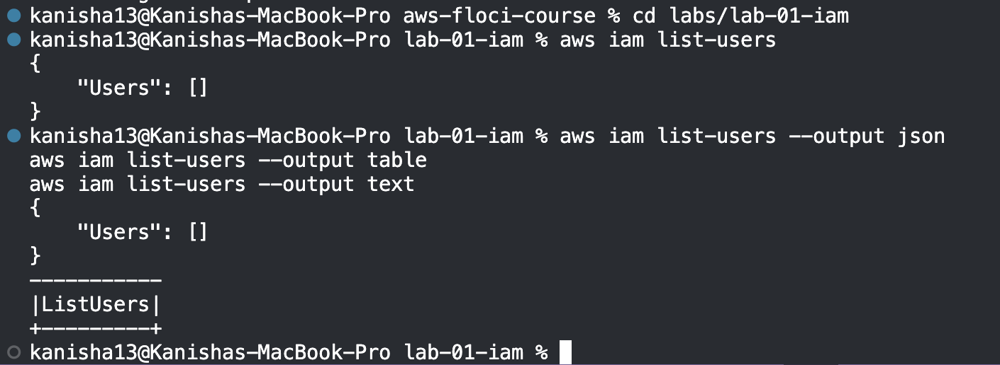

**Step 18:** Created IAM groups: `usms-admins`, `usms-developers`, `usms-auditors`.

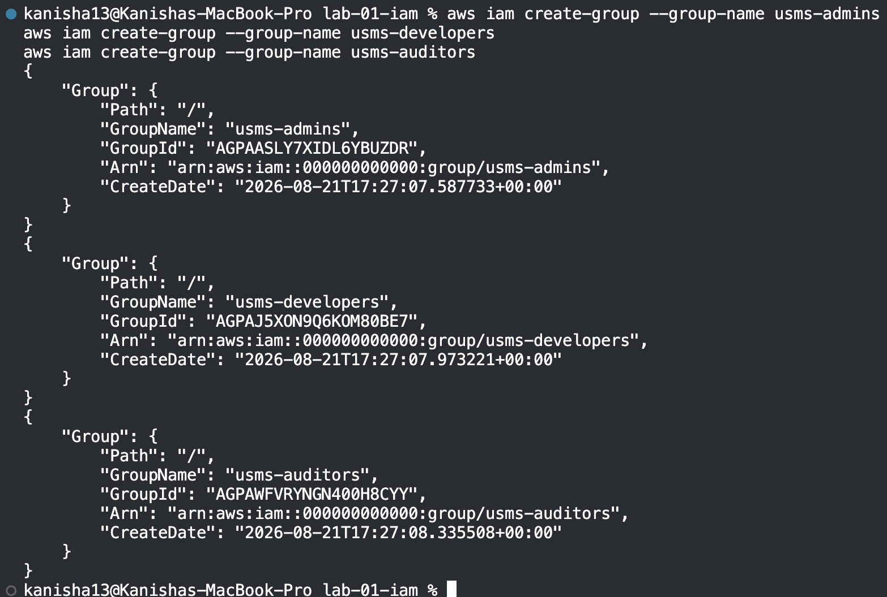

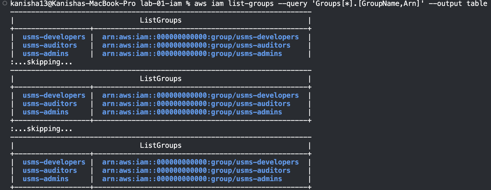

**Step 19:** Created IAM users and captured their ARNs.

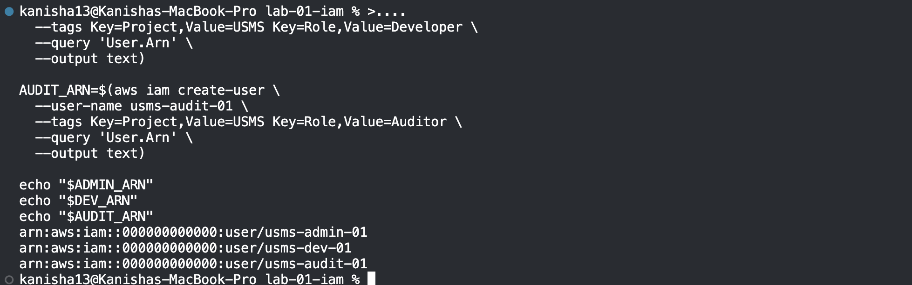

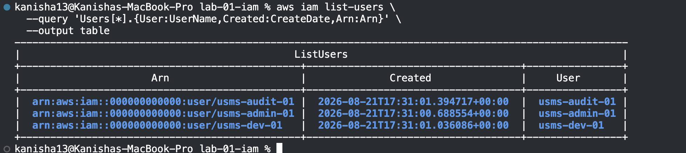

**Step 20:** Added each user to their corresponding group.

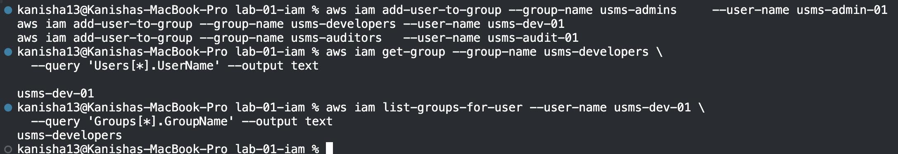

**Step 21:** Attached the AWS managed `ReadOnlyAccess` policy to the auditors group.

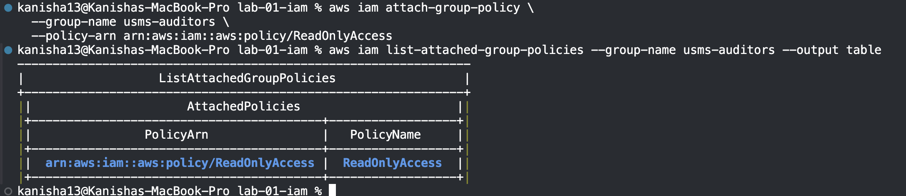

**Step 22:** Wrote and attached a customer managed policy, `USMSDeveloperBase`.

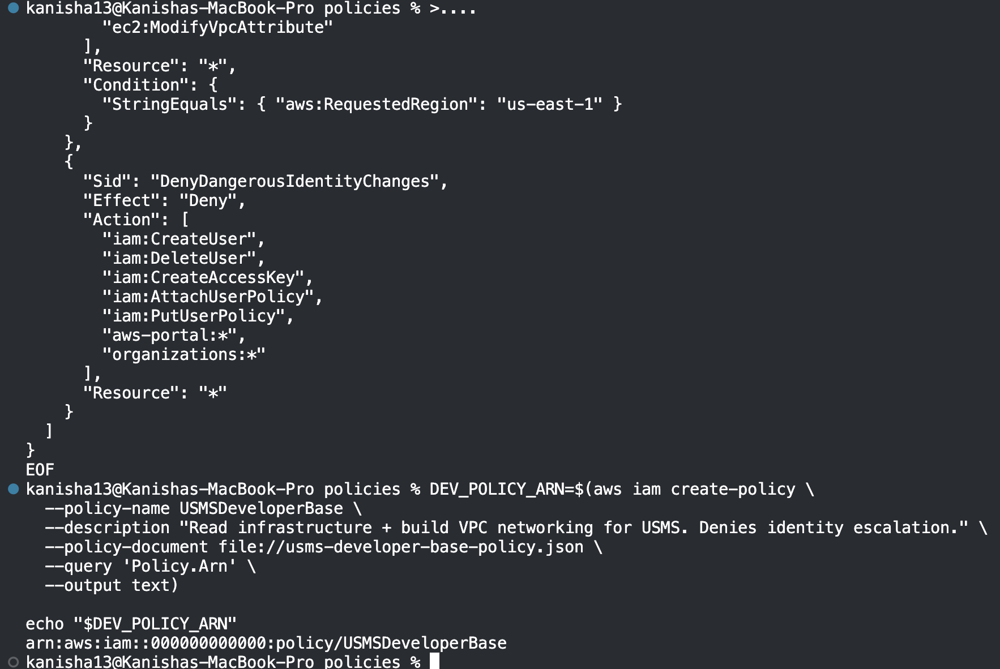

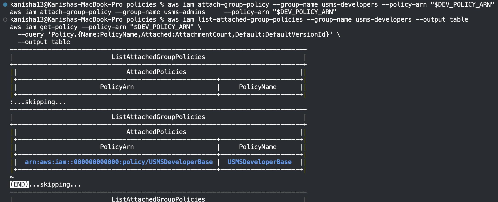

**Step 23:** Wrote the S3 data policy, `USMSStudentDataReadWrite`.

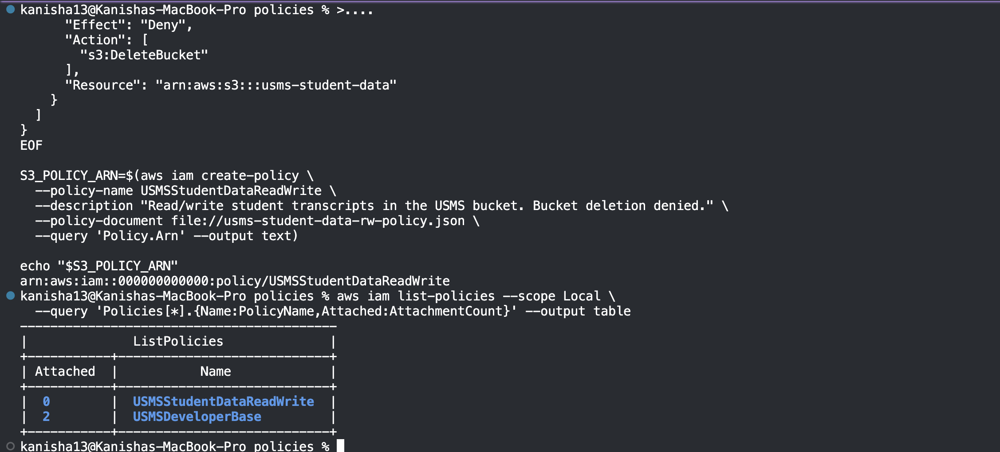

**Step 24:** Used `--generate-cli-skeleton` to discover command parameters.

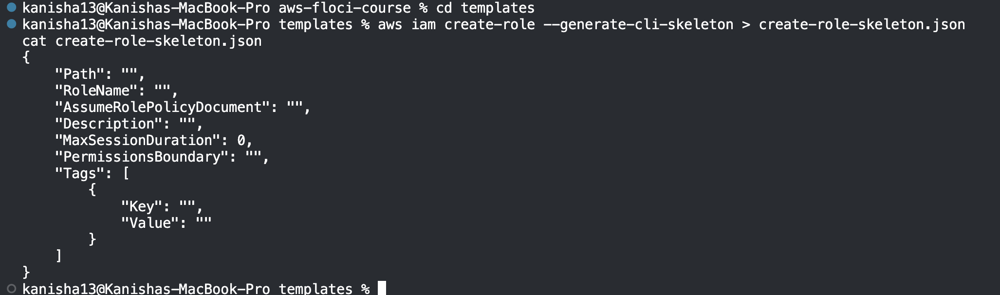

**Step 25:** Added an inline policy for self-service credential management.

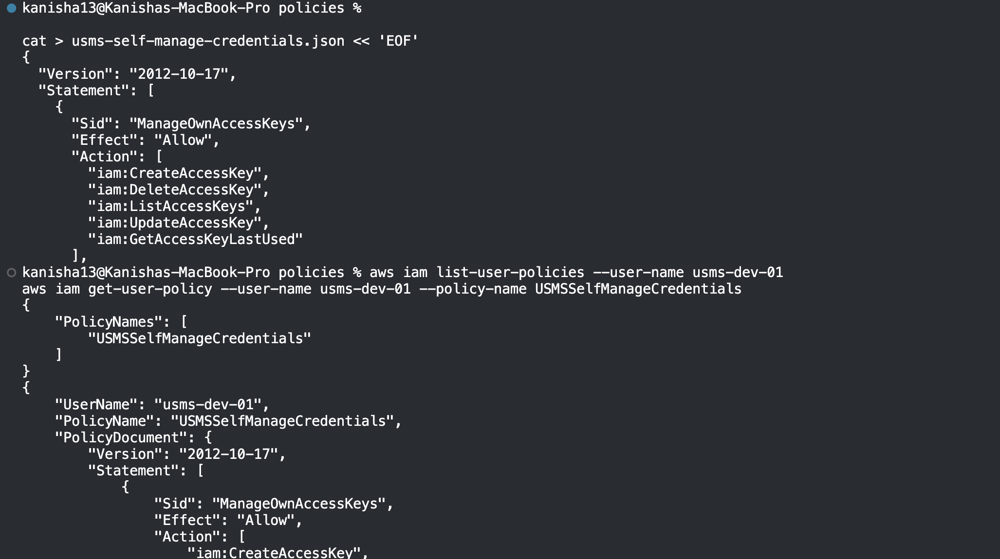

**Step 26:** Inspected all users, groups, and policies built so far.

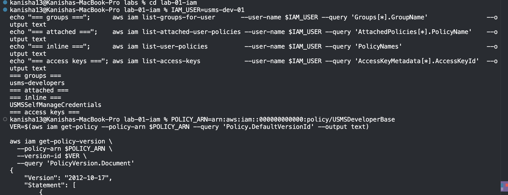

**Step 27:** Explored policy versions with `create-policy-version`.

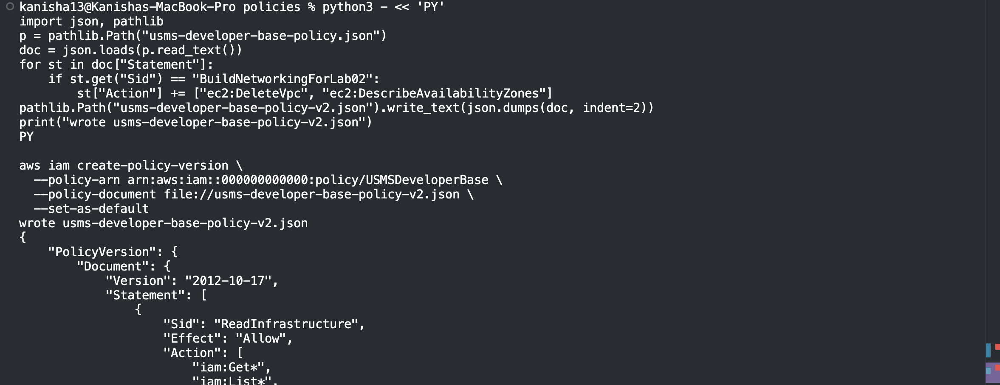

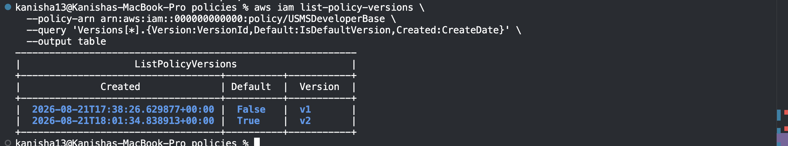

**Step 28:** Created `usms-ec2-app-role` with an EC2 trust policy.

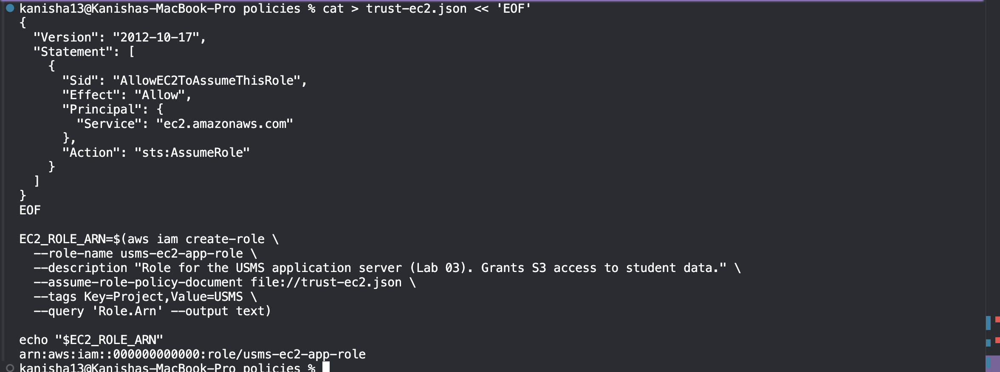

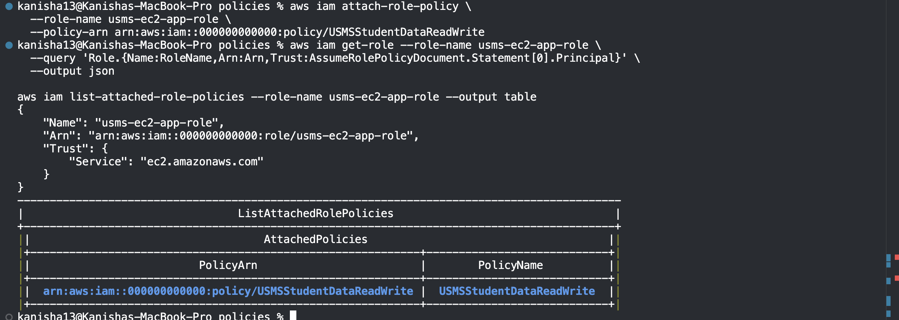

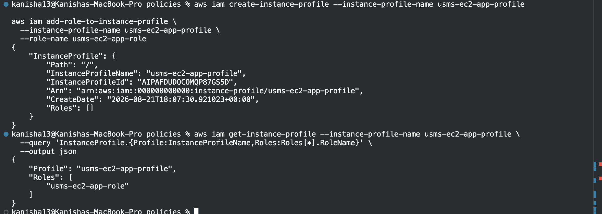

**Step 29:** Created `usms-lambda-exec-role` with a Lambda trust policy.

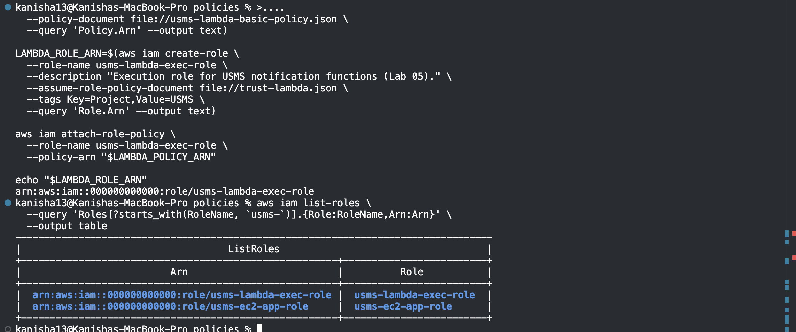

**Step 30:** Created `usms-developer-role` and obtained temporary credentials via STS.

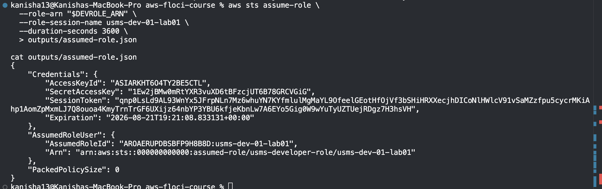

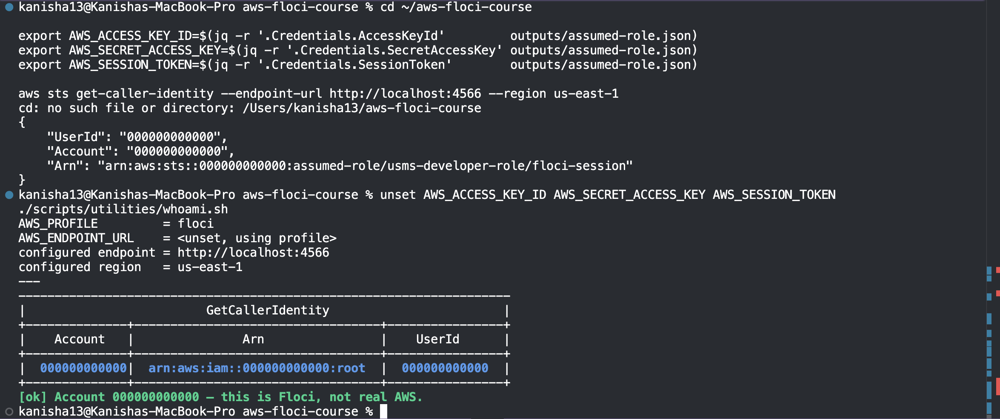

**Step 31:** Created an access key pair for `usms-dev-01`, stored outside Git.

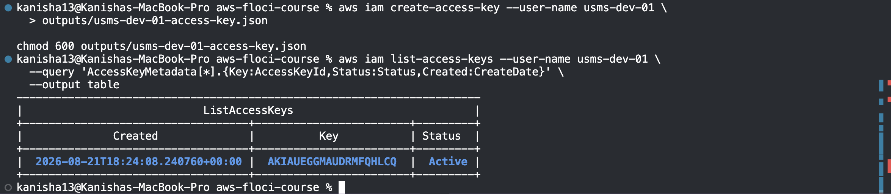

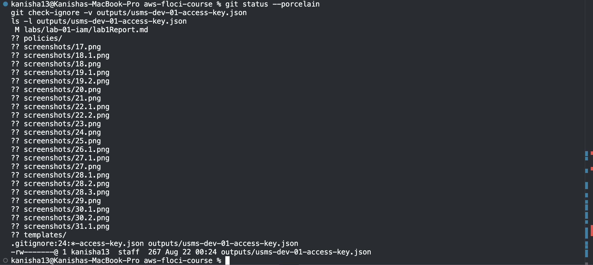

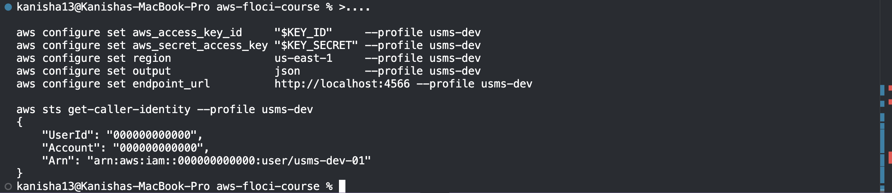

**Step 32:** Tested permissions using the IAM policy simulator.

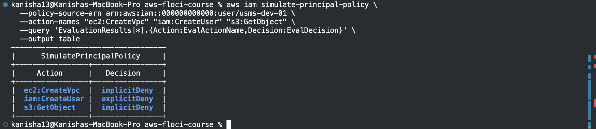

**Step 33:** Saved lab resource identifiers to `configs/lab-01.env` for future labs.

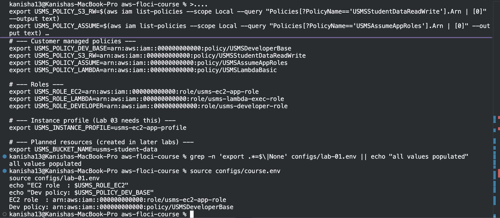

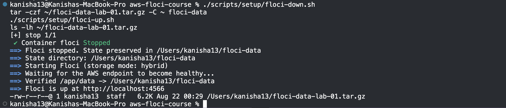

---

## 6. Results and Evidence

### 6.1 AWS Management Console Verification

---

## 7. Analysis and Discussion

- **Completed:** Local AWS environment and complete IAM stack (groups, users, roles, policies) built through the AWS CLI.
- **Meets expectations:** Yes – eventually got past all the checkpoints, including Steps 14 and 30, which were the isolation and persistence proofs and role assumption respectively, although not initially.
- **Error messages:** AWS CLI returned `dlopen`, `pyexpat` errors due to a corrupted Homebrew installation of Python that rendered the `floci` profile non-functional and returned `NoCredentials` errors in subsequent commands. I also tried to execute some commands in the wrong absolute path (`~/aws-floci-course/...`) where the actual project was located in `~/Desktop/aws-floci-course/...`.
- **Fixing the errors:** Reinstalled AWS CLI to resolve the issue with Python, then went back to re-execute Step 12 `aws configure set` command to configure `floci` profile correctly. For the path issues, I switched to using relative paths (like `outputs/assumed-role.json`) within the project folder rather than absolute ones.
- **Findings:** Floci validates policies, but `AccessDenied` is not automatically enforced. Therefore, policy simulator is used for testing logical permissions.
---

## 8. Reflection

1. **What did you learn about this AWS service?**
   I learned how IAM ties together users, groups, roles, and policies to control access, and how ARNs uniquely identify every resource. I also got a much clearer picture of the difference between permissions policies and trust policies, and why roles are assumed rather than logged into directly.

2. **What challenges did you encounter?**
Unfortunately, my AWS CLI stopped working due to the Python/libexpat conflict caused by the Homebrew installation, and therefore I have been getting NoCredentials errors because the profile floci never worked. Another thing that I spent some time on is the incorrect path of the directory containing the project; the path should be ~/aws-floci-course, not ~/Desktop/aws-floci-course.

3. **How would you apply this service in a real-world cloud environment?**
IAM Groups and Roles would be used to implement least privilege on a real team, providing developers and auditors only access that they require rather than having more privileges, and IAM roles and trust policy can be used for services such as EC2 and Lambda rather than embedding credentials.

4. **What additional concepts or features would you like to explore?**
I would like to look into permission boundary limits, SCPs of AWS Organizations, and MFA and conditional access policies within an actual multi-user environment on AWS.

---

## 9. Conclusion

This practical exercise set up a reproducible AWS local environment using Floci and Docker Compose, then created the full IAM base by creating groups, users, roles, and all three kinds of policies for a fictitious student management system. The key topics that were reviewed in this practical session included the concept of ARNs, differences between permission and trust policies, and the principle of least privilege. The skills that we developed in this lab included the use of AWS CLI commands, proper management of secrets via Git, and writing diagnostic scripts.
---

## 10. Appendix (Optional)

- Policy files: `policies/*.json`
- Config files: `configs/course.env`, `configs/lab-01.env`
- Scripts: `scripts/setup/`, `scripts/utilities/`, `scripts/cleanup/`
- Lab source: [Lab 1 – IAM (DSO303)](https://norbutlepcha25.github.io/dso303/Lab/Lab-01-IAM.html)