# Lab Report: Lab 1 – Identity and Access Management (IAM)
**Course:** DSO303
**Lab Reference:** Lab 1 - IAM (AWS CLI + Floci local emulator)

---

## 1. Aim / Objective

To create and manage IAM users, groups, roles, and policies using the AWS CLI against a local Floci AWS emulator, and verify access permissions.

---

## 2. Introduction

The role of AWS Identity and Access Management (IAM) is to determine the rights that individuals have regarding particular resources on AWS. IAM enables administrators to set up users, groups, and roles and add JSON policies specifying allowed or forbidden actions. Some important features include AWS-managed policies, customer-managed policies, inline policies, role trust policies, and temporary access credentials through STS. IAM is essential for cloud computing since all other AWS services depend on IAM for authorizations. Poorly configured IAM often leads to breaches and access interruptions. Common use cases include managing employee or developer access, allowing services such as EC2 and Lambda to act with certain rights using roles.

---

## 3. Use Case

- Managing employee/developer identities and permissions through AWS IAM
- Giving EC2 application server permission to access an S3 bucket through an IAM role.
- Enabling developers to have temporary access to increased permissions using STS assume-role.

---

## 5. Implementation Procedure

**Step 1:** Checked OS, shell, and `$HOME` path.

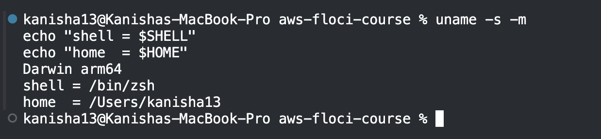

**Step 2:** Verified Docker and Docker Compose v2 were installed and running.

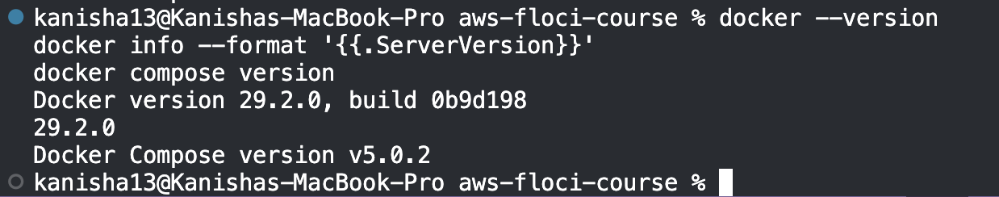

**Step 3:** Installed the Floci CLI (local AWS emulator).

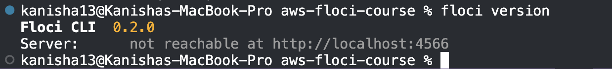

**Step 4:** Ran `floci doctor` to check the environment before starting

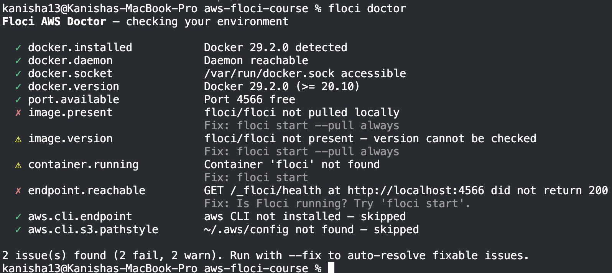

**Step 5:** Created the project directory structure.

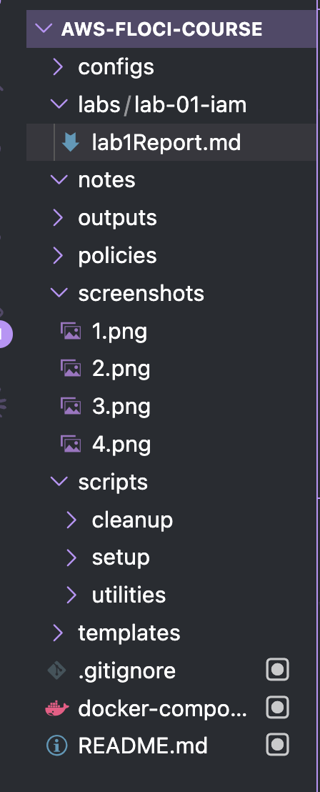

**Step 6:** Wrote `.gitignore` and initialized Git before any secret existed.

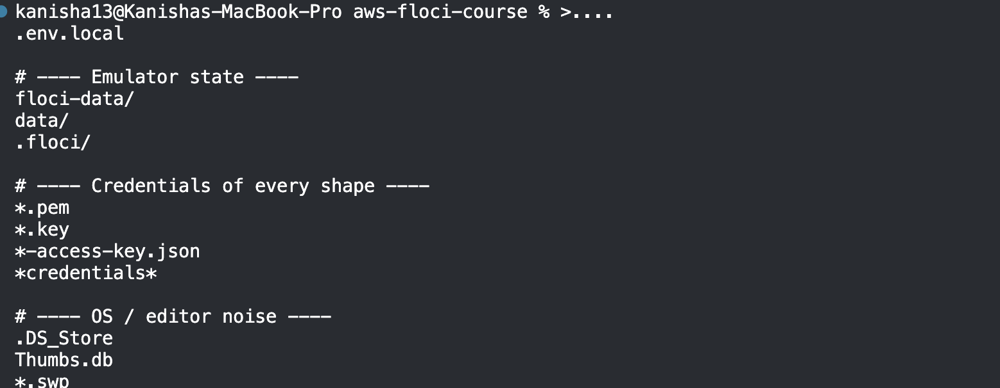

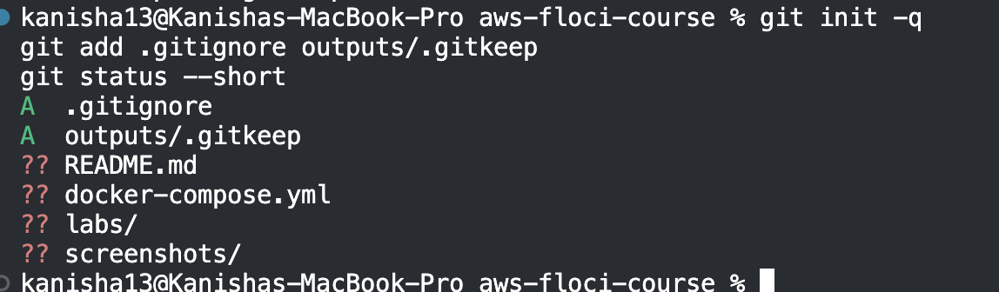

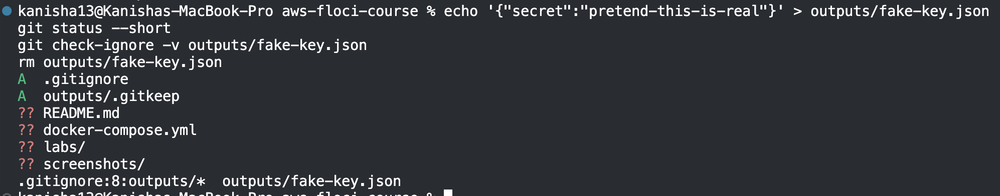

**Step 7:** Reviewed Floci's storage modes and chose `hybrid` for durability.

**Step 8:** Wrote `docker-compose.yml` and `configs/course.env`.

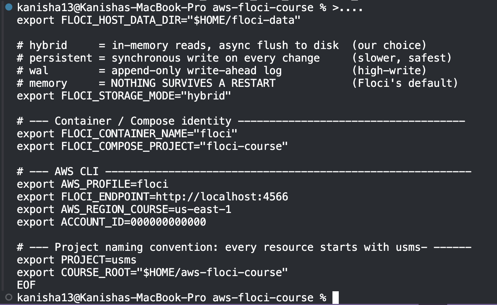

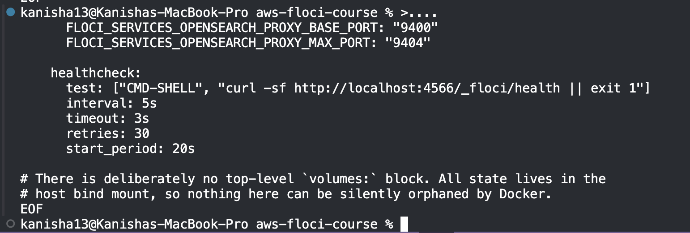

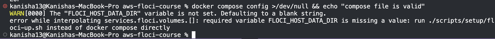

**Step 9:** Wrote start/stop scripts and brought Floci up.

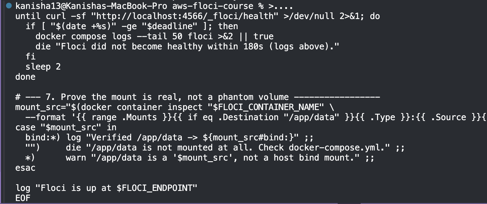

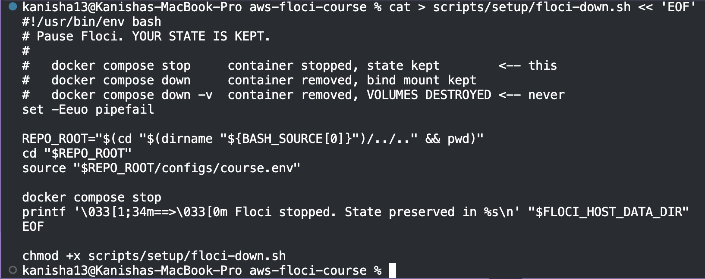

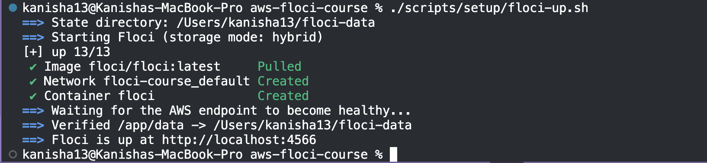

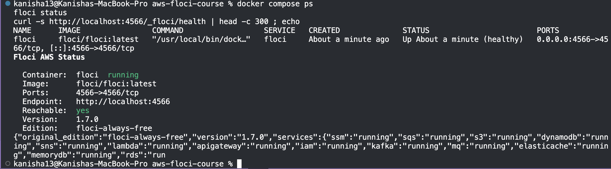

**Step 10:** Installed AWS CLI v2 and verified the version.

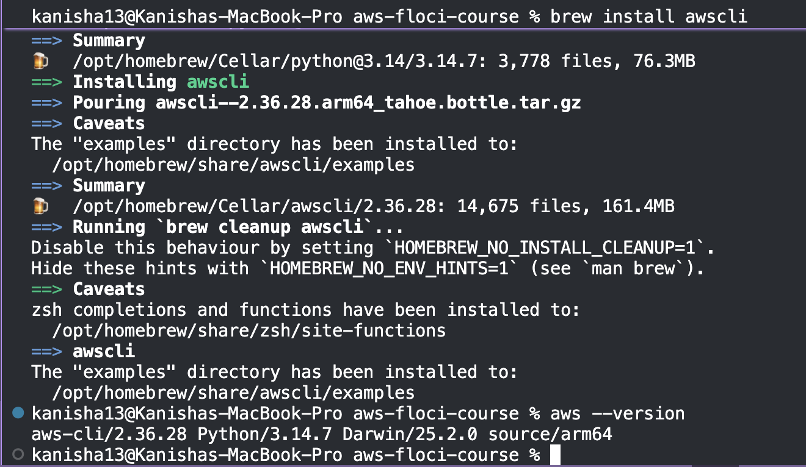

**Step 11:** Reviewed AWS credentials, regions, and profiles.

**Step 12:** Created the `floci` AWS CLI profile pointing at `localhost:4566`.

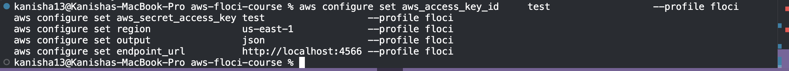

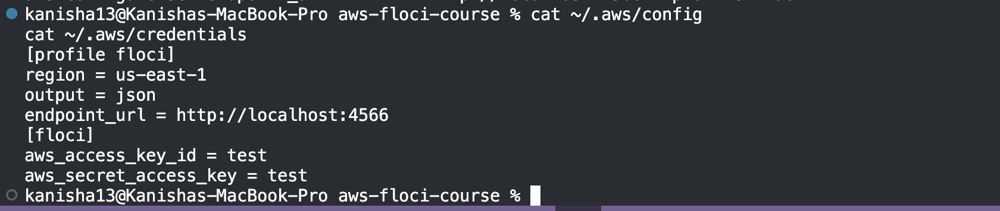

**Step 13:** Ran `aws sts get-caller-identity` and wrote a `whoami.sh` helper.

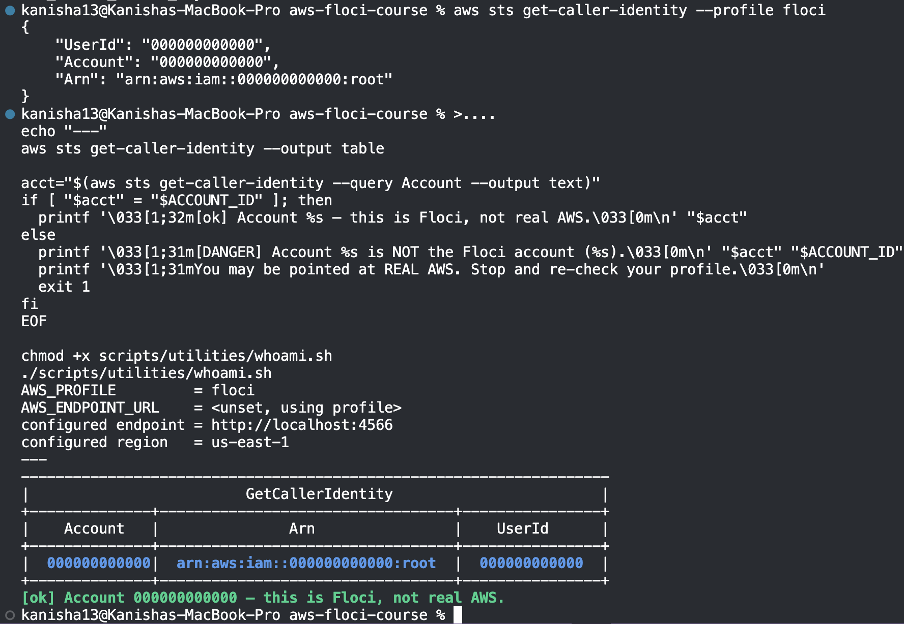

**Step 14:** Proved isolation from real AWS and proved data persistence across a restart.

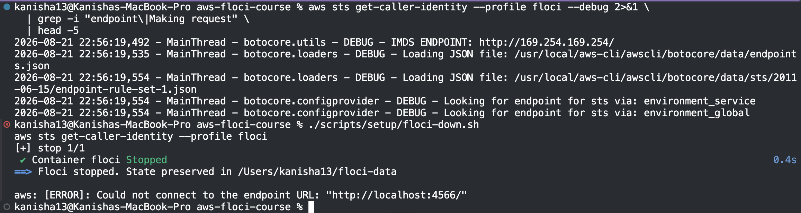

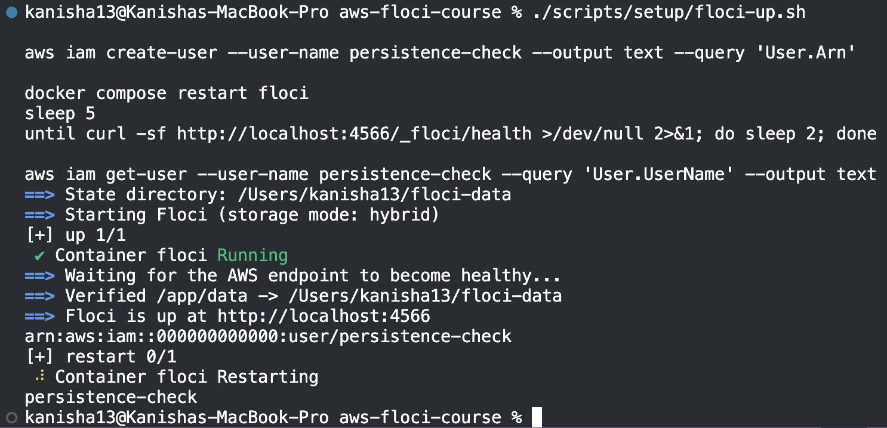

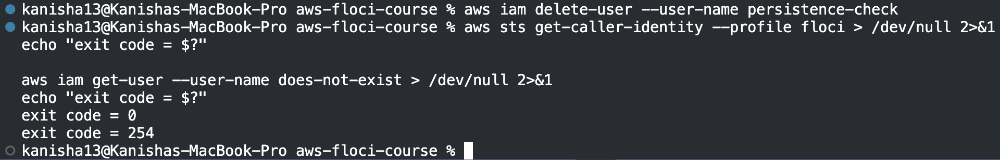

**Step 15:** Wrote storage diagnostics, a README, and committed Part A to Git.

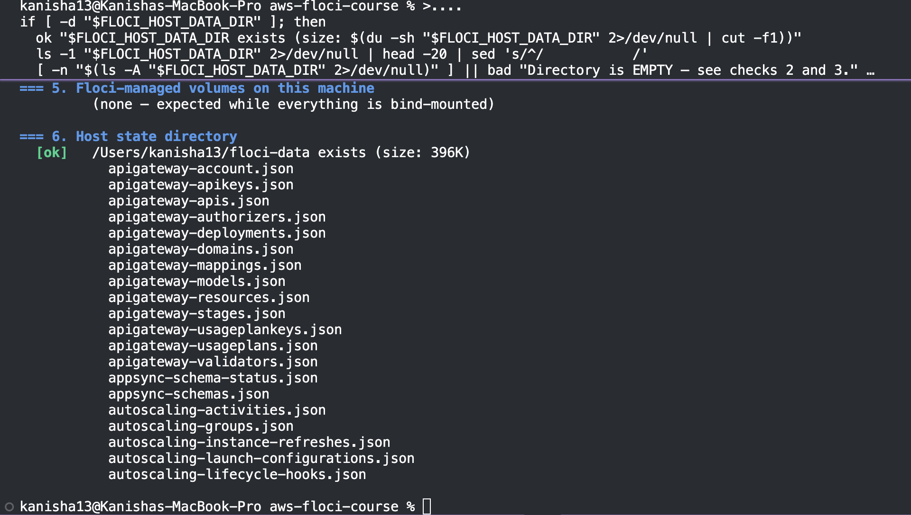

**Step 16:** Reviewed IAM concepts: users, groups, roles, policies, and ARN structure.

**Step 17:** Inspected the empty IAM account (`aws iam list-users`).

**Step 18:** Created IAM groups: `usms-admins`, `usms-developers`, `usms-auditors`.

**Step 19:** Created IAM users and captured their ARNs.

**Step 20:** Added each user to their corresponding group.

**Step 21:** Attached the AWS managed `ReadOnlyAccess` policy to the auditors group.

**Step 22:** Wrote and attached a customer managed policy, `USMSDeveloperBase`.

**Step 23:** Wrote the S3 data policy, `USMSStudentDataReadWrite`.

**Step 24:** Used `--generate-cli-skeleton` to discover command parameters.

**Step 25:** Added an inline policy for self-service credential management.

**Step 26:** Inspected all users, groups, and policies built so far.

**Step 27:** Explored policy versions with `create-policy-version`.

**Step 28:** Created `usms-ec2-app-role` with an EC2 trust policy.

**Step 29:** Created `usms-lambda-exec-role` with a Lambda trust policy.

**Step 30:** Created `usms-developer-role` and obtained temporary credentials via STS.

**Step 31:** Created an access key pair for `usms-dev-01`, stored outside Git.

**Step 32:** Tested permissions using the IAM policy simulator.

**Step 33:** Saved lab resource identifiers to `configs/lab-01.env` for future labs.

---

## 6. Results and Evidence

### 6.1 CLI / SDK Output
*Insert screenshot(s) here*

### 6.2 AWS Management Console Verification
*Insert screenshot(s) here*
> Note: This lab uses Floci (a CLI-only local AWS emulator), so there is no AWS Console. If required, substitute Floci CLI inspection output (`aws iam list-users`, `list-groups`, `list-roles`) as evidence instead.

---

## 7. Analysis and Discussion

- **Achieved:** A working local AWS environment and a complete IAM foundation (groups, users, roles, policies) built entirely via the AWS CLI.
- **Matched expectations:** [Confirm whether all checkpoints passed.]
- **Errors encountered:** [e.g., storage mode defaulting to `memory`, `.gitignore` misconfiguration.]
- **Resolution:** [How issues were fixed.]
- **Observations:** Floci stores and validates policies but does not enforce `AccessDenied` by default, so the policy simulator was used instead to check logical permissions.

---

## 8. Reflection

1. **What did you learn about this AWS service?**
   [Your reflection]

2. **What challenges did you encounter?**
   [Your reflection]

3. **How would you apply this service in a real-world cloud environment?**
   [Your reflection]

4. **What additional concepts or features would you like to explore?**
   [Your reflection]

---

## 9. Conclusion

This practical set up a reproducible local AWS environment using Floci and Docker Compose, then built a complete IAM foundation — groups, users, roles, and policies of all three types — for a fictional student management system. Key concepts reinforced include ARN structure, the difference between permissions and trust policies, and the principle of least privilege. Skills developed include structured AWS CLI usage, safe secrets handling with Git, and diagnostic scripting. IAM is foundational to cloud security, and the identities built here will be reused in later labs.

---

## 10. Appendix (Optional)

- Policy files: `policies/*.json`
- Config files: `configs/course.env`, `configs/lab-01.env`
- Scripts: `scripts/setup/`, `scripts/utilities/`, `scripts/cleanup/`
- Lab source: [Lab 1 – IAM (DSO303)](https://norbutlepcha25.github.io/dso303/Lab/Lab-01-IAM.html)