# Exercise 1 — Basic: a third public subnet

### 1. Create the subnet (pattern from Step 7)

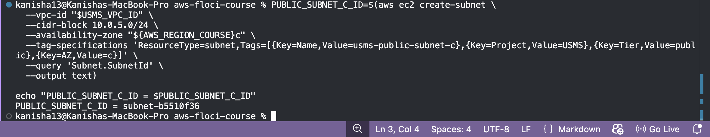

### 2. Auto-assign public IPv4 (pattern from Step 8)

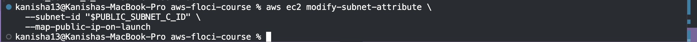

### 3. Associate with the public route table (pattern from Step 11)

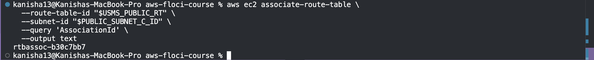

### Verify — expect the subnet listed + one more association than before

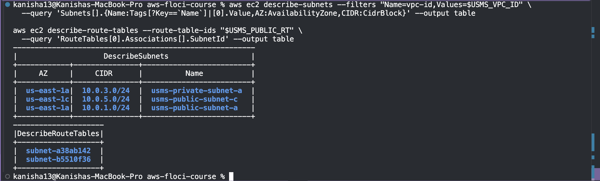

# Exercise 2 — Intermediate: a bastion security group

### 1. Create the bastion security group

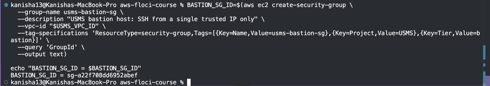

### 2. Inbound SSH from your one trusted IP (use your real public IP, or 203.0.113.10/32)

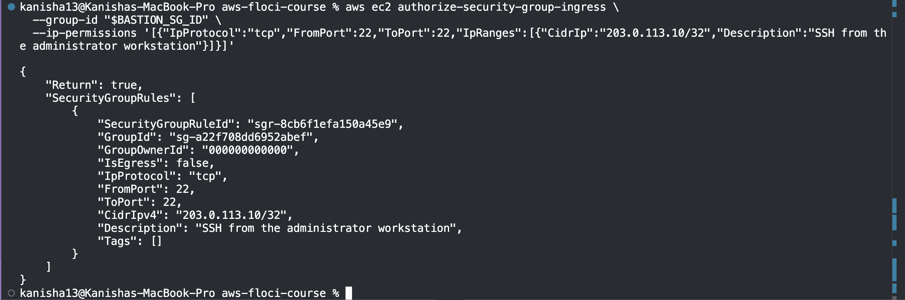

### 3. Add the new group-referenced rule to usms-app-sg

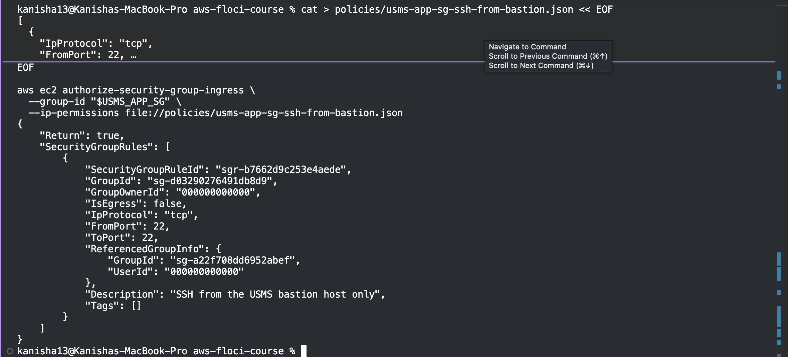

### 4. Find and remove the OLD SSH rule (source 10.0.0.0/16) on usms-app-sg

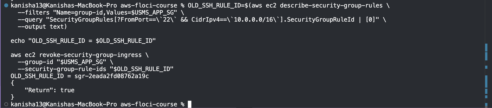

### Verify — expect exactly one SSH rule on app-sg, sourced from bastion-sg

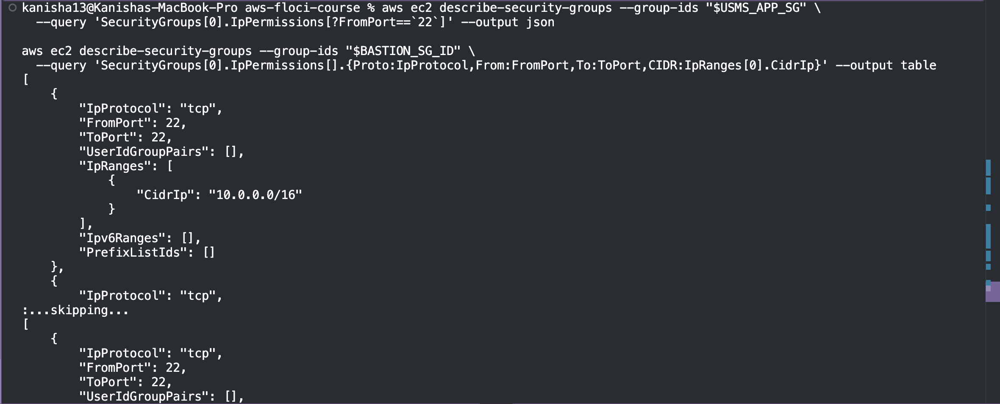

# Exercise 3 — Problem solving: prove a claim about the network

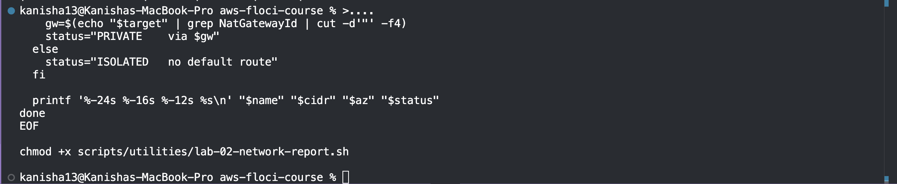

### Run it from two different directories to prove it's location-independent

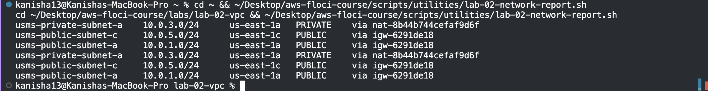

# Exercise 4 — Challenge: design and defend

Design doc:

- Subnet placement: usms-private-subnet-a (or -b): It will read the transcript DB and should never have an internet connection; a private subnet with NAT-outbound only meets "reachable from campus, needs patches, never from the internet."

- Security group: new usms-exam-sg, inbound TCP 443 (or the port number used by the application) from 10.10.0.0/16 (the campus network) only, each with a description.

- NACL: nothing to change here—the private NACL currently in place allows VPC-inbound traffic and HTTPS outbound traffic; campus traffic comes in as VPC traffic via the VPN and the current NACL rule of 10.0.0.0/16 will cover it.

- Second NAT gateway: explain the pros/cons—basically, one NAT gateway is a tradeoff between saving money and having a single point of failure for both AZs; two NAT gateways cost approximately twice the current largest line item in the NAT bill, but allows full AZ independence. Make sure to give your choice based on current pricing.

- What to delete: usms-public-subnet-c from Exercise 1 — correct order is: disassociate and then delete-subnet.

### Implementation (security group only):

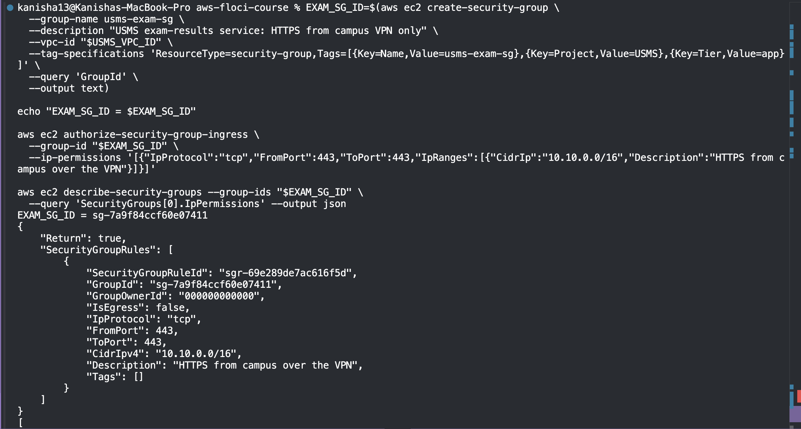

# Exercise 5 — Integration: complete the second Availability Zone

### 1. Assume the developer role (pattern from Step 3)

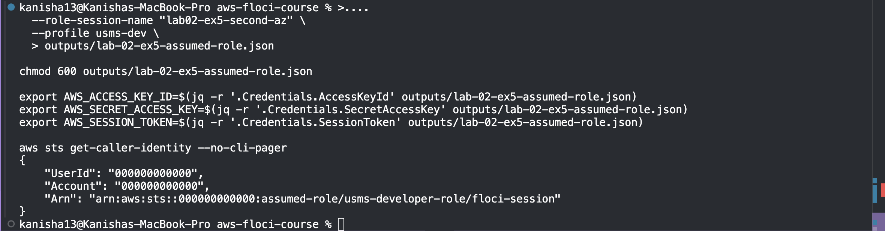

### 2. Create the second private subnet

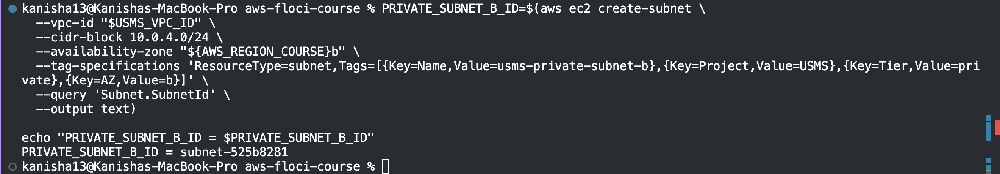

### 3. Associate with the existing private route table

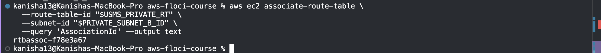

### 4. Replace its default NACL association with usms-private-nacl (pattern from Step 18)

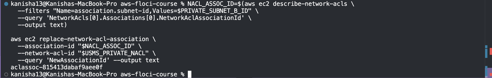

### 5. Restore your normal identity immediately (pattern from Step 4)

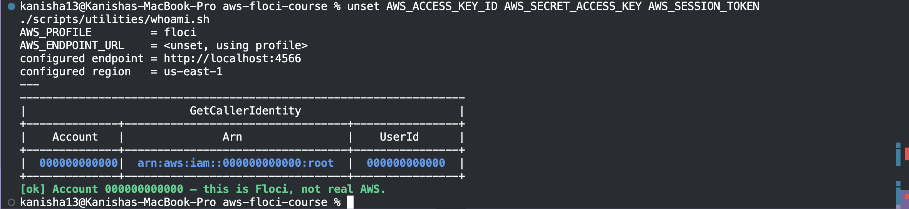

