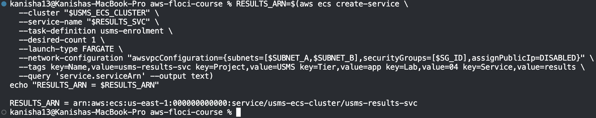
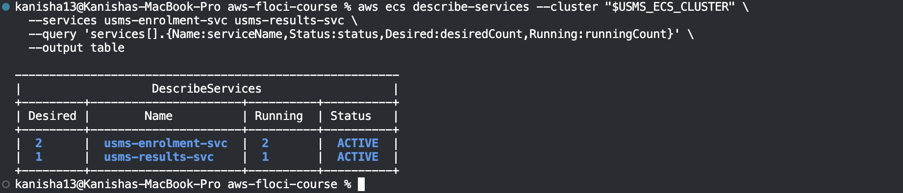
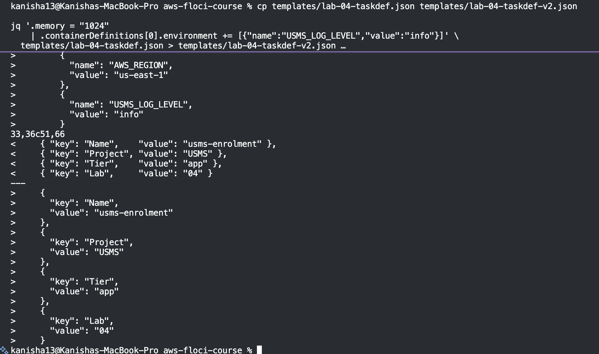
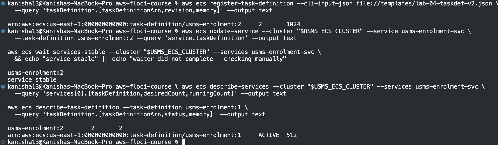
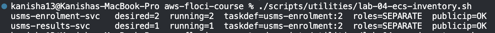
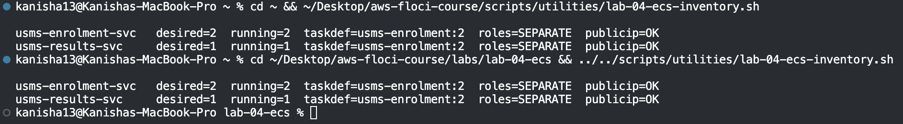
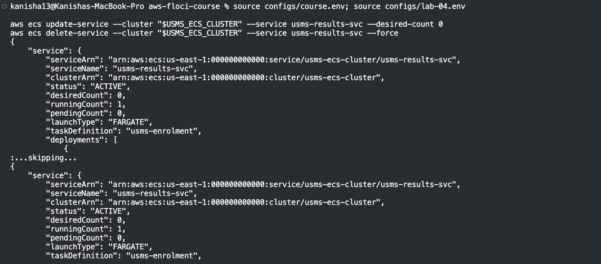
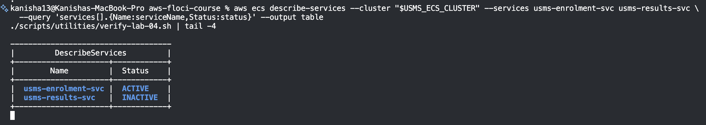
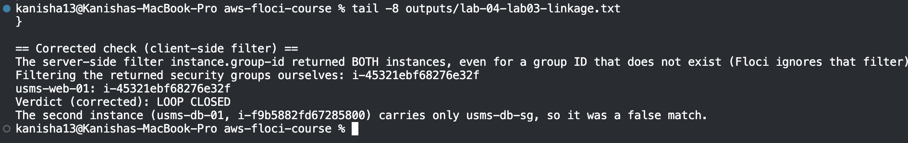
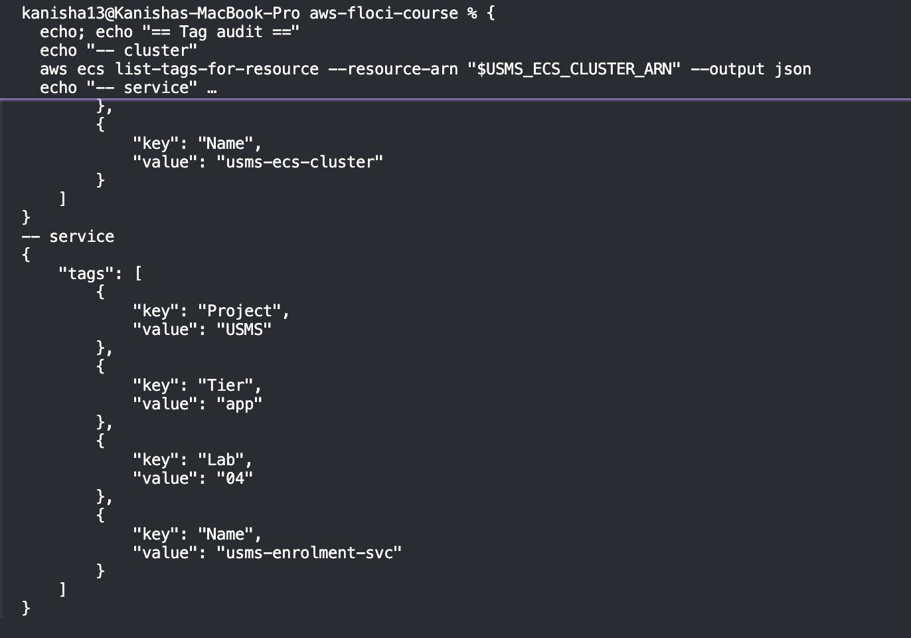

# Lab 04 – Independent Exercises

## Exercise 1 – A second service, deployed

**Task:** Create `usms-results-svc` in `usms-ecs-cluster` from the `usms-enrolment` task definition, desired count 1, both private subnets, carrying `usms-enrolment-sg`. Not recorded in `configs/lab-04.env` (Exercise 4 removes it).

### Commands

```bash
RESULTS_SVC="usms-results-svc"
SG_ID=$(aws ec2 describe-security-groups --filters "Name=group-name,Values=usms-enrolment-sg" \
  --query 'SecurityGroups[0].GroupId' --output text)
SUBNET_A=$(aws ec2 describe-subnets --filters "Name=tag:Name,Values=usms-private-subnet-a" \
  --query 'Subnets[0].SubnetId' --output text)
SUBNET_B=$(aws ec2 describe-subnets --filters "Name=tag:Name,Values=usms-private-subnet-b" \
  --query 'Subnets[0].SubnetId' --output text)

RESULTS_ARN=$(aws ecs create-service \
  --cluster "$USMS_ECS_CLUSTER" --service-name "$RESULTS_SVC" \
  --task-definition usms-enrolment --desired-count 1 --launch-type FARGATE \
  --network-configuration "awsvpcConfiguration={subnets=[$SUBNET_A,$SUBNET_B],securityGroups=[$SG_ID],assignPublicIp=DISABLED}" \
  --tags key=Name,value=usms-results-svc key=Project,value=USMS key=Tier,value=app key=Lab,value=04 key=Service,value=results \
  --query 'service.serviceArn' --output text)
```



### Result

Both services are ACTIVE with different names and desired counts (2 and 1).

```bash
aws ecs describe-services --cluster "$USMS_ECS_CLUSTER" \
  --services usms-enrolment-svc usms-results-svc \
  --query 'services[].{Name:serviceName,Status:status,Desired:desiredCount,Running:runningCount}' --output table
```



---

## Exercise 2 – A new revision, and a deployment that does not drop traffic

**Task:** Register `usms-enrolment:2` from a copy of the template with memory raised from 512 to 1024 MiB and a new variable `USMS_LOG_LEVEL=info`. Move `usms-enrolment-svc` to it and confirm revision 1 is still describable.

### Commands

The original template is kept untouched, and the change is made in a copy:

```bash
cp templates/lab-04-taskdef.json templates/lab-04-taskdef-v2.json
jq '.memory = "1024"
    | .containerDefinitions[0].environment += [{"name":"USMS_LOG_LEVEL","value":"info"}]' \
  templates/lab-04-taskdef.json > templates/lab-04-taskdef-v2.json
diff templates/lab-04-taskdef.json templates/lab-04-taskdef-v2.json
```



Register revision 2, point the service at it, and wait (no fixed sleep):

```bash
aws ecs register-task-definition --cli-input-json file://templates/lab-04-taskdef-v2.json
aws ecs update-service --cluster "$USMS_ECS_CLUSTER" --service usms-enrolment-svc \
  --task-definition usms-enrolment:2
aws ecs wait services-stable --cluster "$USMS_ECS_CLUSTER" --services usms-enrolment-svc
```

Check the result:

```bash
aws ecs describe-services --cluster "$USMS_ECS_CLUSTER" --services usms-enrolment-svc \
  --query 'services[0].[taskDefinition,desiredCount,runningCount]' --output text
aws ecs describe-task-definition --task-definition usms-enrolment:1 \
  --query 'taskDefinition.[taskDefinitionArn,status,memory]' --output text
```



### Result

The service now uses `usms-enrolment:2`, and `usms-enrolment:1` is still ACTIVE and describable.

**What changes and what does not:** the service's `taskDefinition` pointer moves from `:1` to `:2`, but revision 1 itself never changes, because task definition revisions are immutable.

---

## Exercise 3 – An ECS configuration drift report

**Task:** Write `scripts/utilities/lab-04-ecs-inventory.sh`. For every service in the cluster it prints one line with desired and running counts, the task definition revision, whether the execution and task roles are the same or separate, and whether a public IP is enabled. It also writes the same data as JSON to `outputs/lab-04-ecs-inventory.json`.

### How it works

- Services are listed from the cluster (`list-services`), so no service name is hard-coded.
- **roles:** `SAME` if the execution role ARN equals the task role ARN, otherwise `SEPARATE`.
- **publicip:** `RISK` if `assignPublicIp` is ENABLED, `OK` if DISABLED, `N/A` if the service has no network configuration.
- **Paths:** the repo root is found from `${BASH_SOURCE[0]}`, so the script gives the same output from any folder.
- **No `-e`:** it uses `set -uo pipefail`. One service that fails to describe must not abort the whole report, so each lookup is handled explicitly.
- **Revision lookup:** `usms-results-svc` was created with the bare family name, so the script looks up the real revision.

### Result

From the repo folder:



From `~` and from `labs/lab-04-ecs/`, giving the same output:



Both services are classified correctly: `roles=SEPARATE` and `publicip=OK`.

---

## Exercise 4 – The enrolment week capacity plan

**Request from the project lead:** the service fell over for eleven minutes at 08:03 on enrolment Monday, and the same fixed capacity runs at 3am on a Sunday. What should we run, when, what should trigger a change, and what does it cost?

### 4.1 Why a fixed desiredCount of 2 cannot answer the 08:03 problem

`usms-enrolment-svc` reads no metric and no clock. Its `desiredCount` stays at 2 until a person runs `update-service`. Nobody is awake at 08:03 to do that, and even if they were, a new task takes 20 to 60 seconds to start on real Fargate. Capacity has to rise **before** the crowd arrives, and that needs either a schedule or a metric-driven policy. A fixed number can do neither.

### 4.2 Proposed plan (to hand to Lab 06)

**Assumptions** (to be replaced by a real load test; the numbers come from the project lead's scenario):

- Peak traffic is **200 requests per second** in the first 20 minutes.
- One task (256 CPU / 512 MiB) handles about **25 requests per second**.

| Setting | Value | Derivation | Too high costs | Too low costs |
|---|---|---|---|---|
| **Minimum** | 2 | One task per Availability Zone, so one zone failing doesn't take the service down | Paying for idle tasks all week | One zone down means no service |
| **Scheduled floor** | 8, from Mon 07:45 to 08:30 | 200 ÷ 25 = 8 tasks. It starts 15 minutes early because tasks take 20 to 60 seconds to start | Small. 6 extra tasks for 45 minutes | The 08:03 outage happens again |
| **Maximum** | 10 | 8 tasks + 2 for headroom (25 percent) | Small. Only reached under a surge | A busier-than-expected morning overloads the service |

**Trigger for change:** the schedule raises the floor before the window. Target tracking on average CPU (about 60 percent) then adds tasks above 8 if the real load is higher than expected, up to the maximum of 10, and removes them after the window. For the team building the policies, the target is: *never let the service be at capacity at 08:00. Pay for the extra tasks for under an hour a week.*

### 4.3 Monthly cost comparison

**Prices (us-east-1, Linux/x86, On-Demand):** $0.04048 per vCPU-hour and $0.004445 per GB-hour. Source: [AWS Fargate Pricing](https://aws.amazon.com/fargate/pricing/), as quoted by [Vantage](https://www.vantage.sh/blog/fargate-pricing). I could not load the live AWS page during the lab, so please check the figures there before relying on them.

**One task** (0.25 vCPU, 0.5 GB) costs 0.25 × 0.04048 + 0.5 × 0.004445 = **$0.01234 per hour**, or about **$9.01 per month** (730 hours).

| Option | Tasks | Monthly cost | Works at 08:03? |
|---|---|---|---|
| A. Fixed at today's 2 | 2 all month | 2 × $9.01 = **$18.02** | **No.** Capacity is 2 × 25 = 50 requests per second against 200 |
| B. Fixed at the peak (10) | 10 all month | 10 × $9.01 = **$90.10** | Yes, but about 8 of the 10 tasks sit idle nearly all week |
| C. Proposed plan | 2 base, 8 for 45 min each Monday, up to 10 for 20 min | $18.02 + 6 tasks × 3.25 h × $0.01234 + 2 tasks × 1.44 h × $0.01234 = **about $18.30** | Yes |

The window is 0.75 hours × 52 weeks ÷ 12 months = 3.25 hours a month. The 20-minute peak is 1.44 hours a month.

**Conclusion:** the proposed plan costs about **$0.28 more** than today's fixed 2, and **about $71.80 less** than running at peak all month (about 80 percent cheaper). It is the only option that is both cheap and ready for 08:03.

### 4.4 What to switch off

Only `usms-results-svc` (the Exercise 1 practice service) goes. Nothing in the KEEP column of Section 15 is touched.

> **DANGER - read before running.**
> **What will be deleted:** the service `usms-results-svc` only.
> **What depends on it:** nothing. It was created for Exercise 1 and is not recorded in `configs/lab-04.env`.
> **Reversible?** Yes. Re-run the Exercise 1 commands to create it again.
> **Effect on later labs:** none. `usms-enrolment-svc`, the cluster, the roles and the log group are kept.

Commands in dependency order (scale to zero, then delete):

```bash
aws ecs update-service --cluster "$USMS_ECS_CLUSTER" --service usms-results-svc --desired-count 0
aws ecs delete-service --cluster "$USMS_ECS_CLUSTER" --service usms-results-svc --force
```

Check, then confirm the lab check still passes:

```bash
aws ecs describe-services --cluster "$USMS_ECS_CLUSTER" --services usms-enrolment-svc usms-results-svc \
  --query 'services[].{Name:serviceName,Status:status}' --output table
./scripts/utilities/verify-lab-04.sh
```

### 4.5 Result of the deletion

Scaled `usms-results-svc` to 0 and deleted it:



The service now shows as INACTIVE (deleted), `usms-enrolment-svc` is untouched, and the verify script still passes apart from the known `.gitkeep` false alarm:



---

## Exercise 5 – Close the loop back to Lab 3, and hand Lab 05 what it needs

**Task:** Resolve `usms-enrolment-sg`'s only inbound source group back to the instance that carries it, confirm it is `usms-web-01`, and record the result in `outputs/lab-04-lab03-linkage.txt` for Lab 05. Then audit the tags on the cluster and the service.

### Commands

```bash
SRC_SG=$(aws ec2 describe-security-groups --group-ids "$USMS_ENROLMENT_SG" \
  --query 'SecurityGroups[0].IpPermissions[0].UserIdGroupPairs[0].GroupId' --output text)

FOUND=$(aws ec2 describe-instances \
  --filters "Name=instance.group-id,Values=$SRC_SG" "Name=instance-state-name,Values=running" \
  --query 'Reservations[].Instances[].InstanceId' --output text)
```

The result was written to `outputs/lab-04-lab03-linkage.txt`:



### The mismatch, and why it is not a real one

The first check returned **two** instances (`usms-web-01` and `usms-db-01`), so the verdict was `MISMATCH`. `usms-db-01` carries only `usms-db-sg`, so it should not have matched.

To find out why, the same filter was tried with a group ID that does not exist (`sg-nonexistent`). It still returned both instances. **Floci ignores the `instance.group-id` filter** and returns every instance, a limitation that real AWS does not have.

**Fix:** list the running instances and filter their security groups on the client side:

```bash
aws ec2 describe-instances --filters "Name=instance-state-name,Values=running" \
  --query "Reservations[].Instances[?SecurityGroups[?GroupId=='$SRC_SG']].InstanceId[]" --output text
```

This returns only `usms-web-01`, so the corrected verdict is **LOOP CLOSED**. The corrected result was appended to the same file.

### Tag audit

`list-tags-for-resource` takes an ARN, not a name. Both resources show their tags, so this build stores them:



| Resource | Tags found |
|---|---|
| Cluster `usms-ecs-cluster` | Project=USMS, Tier=app, Name=usms-ecs-cluster |
| Service `usms-enrolment-svc` | Project=USMS, Tier=app, Lab=04, Name=usms-enrolment-svc |

### Note for Lab 05

The rule that lets `usms-app-sg` (the web server) reach the enrolment service on port 80 is **temporary**. Lab 05 removes it once the load balancer becomes the only caller. It is safe to remove because the only instance using the source group is `usms-web-01`.
