# Lab Report: Lab 4 – Amazon ECS (Running Containers on Fargate)

---

## 1. Objectives

- Move the USMS student enrolment service from a single server onto Amazon ECS, a service that runs applications in containers.
- Build the pieces ECS needs: a cluster, a log group, two IAM roles, a firewall (security group), a task definition and a service.
- Keep two copies (tasks) of the service running in two different Availability Zones.
- Save all names and IDs to `configs/lab-04.env` so Labs 05 and 06 can reuse them.

---

## 2. What is ECS?

A **container** is a small, sealed package that holds an app and everything it needs to run. **ECS** is the AWS service that starts and looks after those containers. **Fargate** means AWS handles the servers, so we only describe what we want.

| Term | Everyday meaning |
|---|---|
| Cluster | A named group (a "workspace") where our containers live |
| Task definition | The recipe: which image, how much CPU and memory, which roles |
| Task | One running copy of the recipe |
| Service | The manager that keeps the wanted number of tasks running |
| Execution role | The permission ECS uses to **start** the container (pull the image, write logs) |
| Task role | The permission the **app itself** uses once running (reading and writing S3) |

---

## 3. Steps Followed

### Part A – Setup

**Step 0 – Check tools and create the lab folder.** Confirmed `jq`, `python3`, `docker` and the AWS CLI are installed.

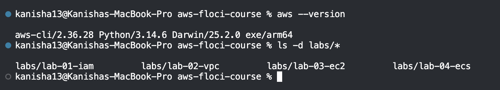

**Step 1 – Start Floci and load settings from Labs 1–3.** All eight values had to be filled in.

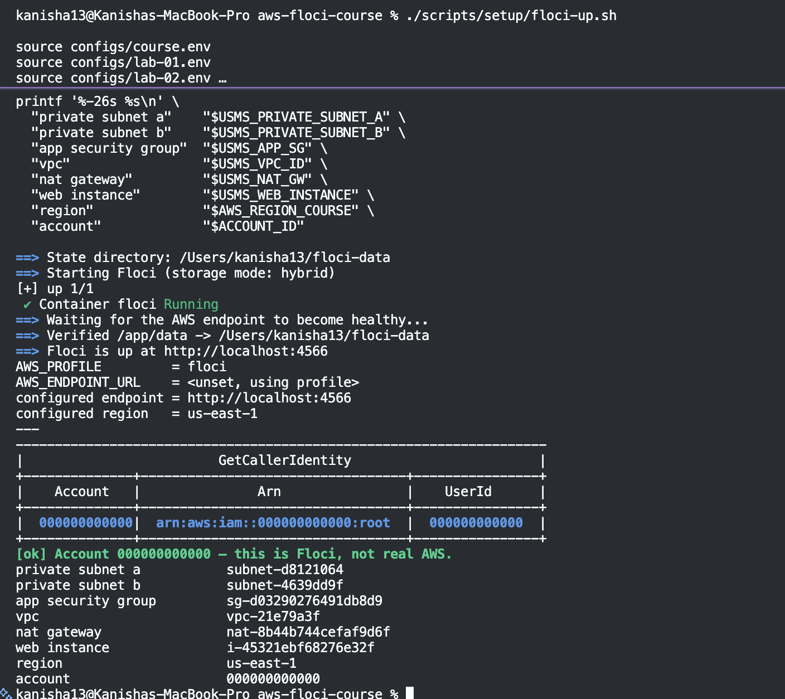

**Step 2 – Check Labs 2 and 3 still work** using their verify scripts.

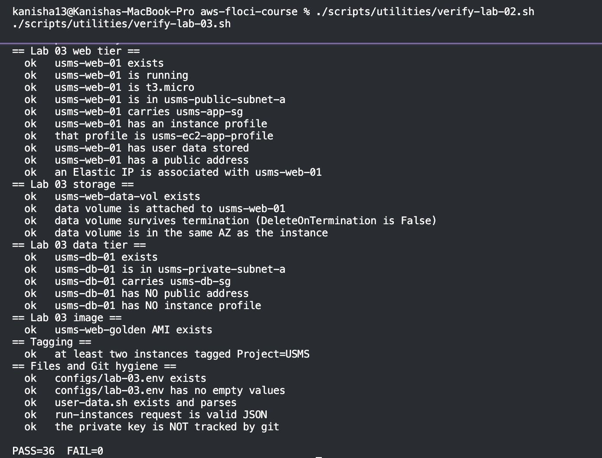

**Step 3 – Probe what this Floci build supports.** ECS works, so the whole lab could be done. Scheduled scaling is not supported (noted for Lab 06).

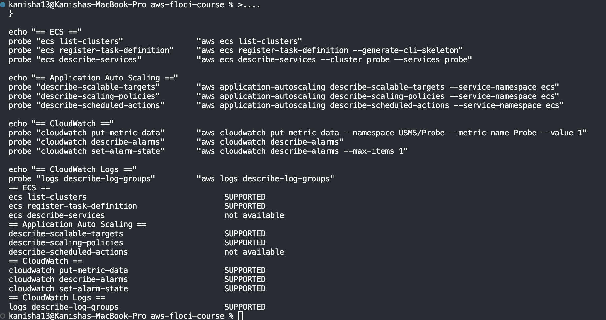

### Part B – Cluster, logs and roles

**Step 4 – Create the ECS cluster.** Temporarily acted as the developer role, created `usms-ecs-cluster`, then switched back to the normal identity.

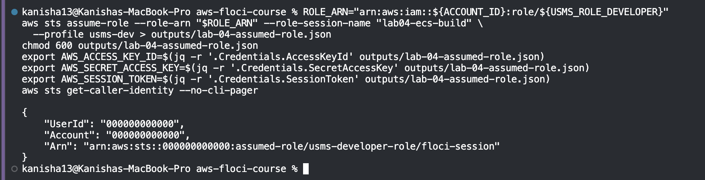

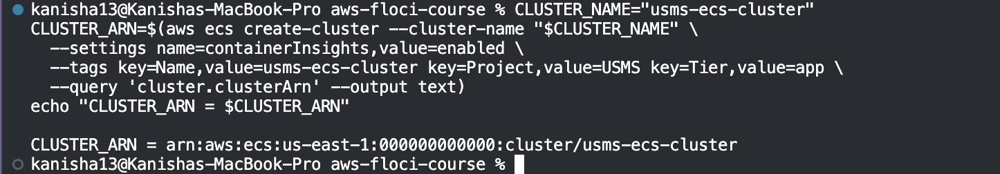

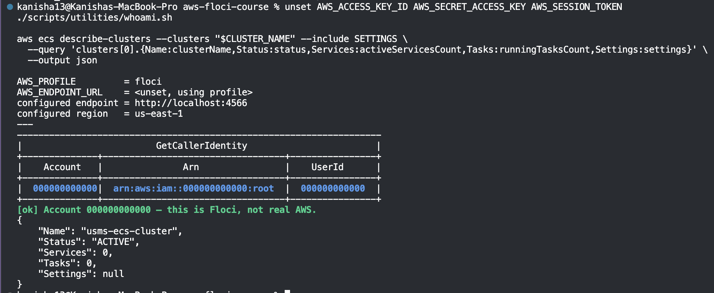

**Step 5 – Create the log group** `/usms/ecs/enrolment` and keep logs for 7 days.

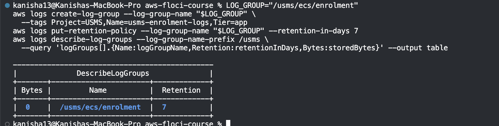

**Step 6 – Create the execution role** `usms-ecs-exec-role` with a small permission policy (pull the image, write logs to one log group only).

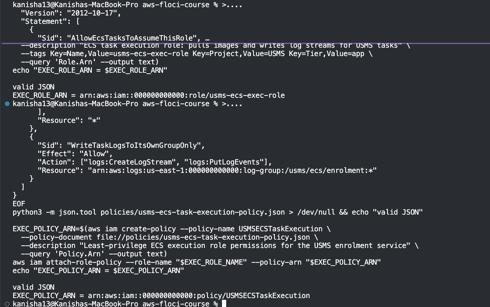

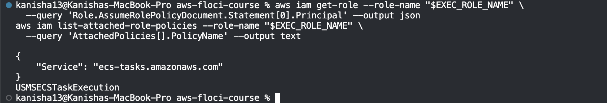

**Step 7 – Create the task role** `usms-ecs-task-role` and attach the S3 read/write policy from Lab 1.

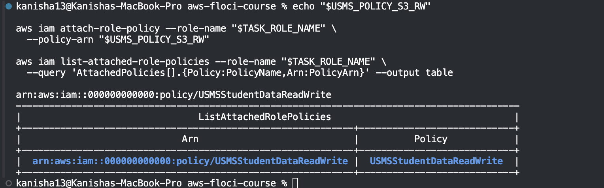

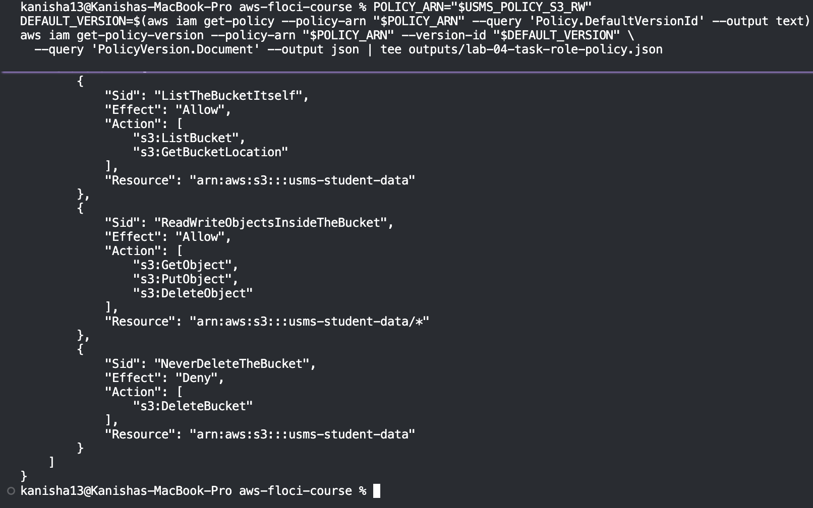

### Part C – Firewall, task definition and service

**Step 8 – Create the security group** `usms-enrolment-sg`. It lets in web traffic (port 80) from the web server's group only.

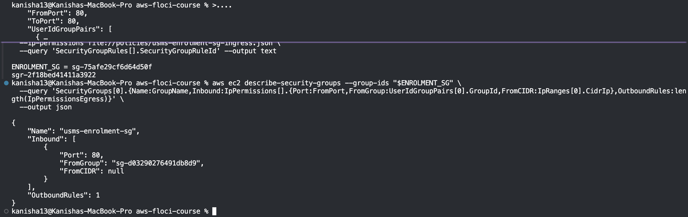

**Step 9 – Write and register the task definition** `usms-enrolment` (256 CPU, 512 MiB, nginx placeholder image).

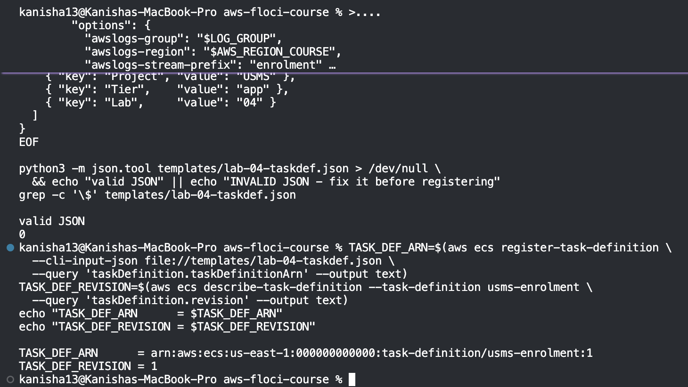

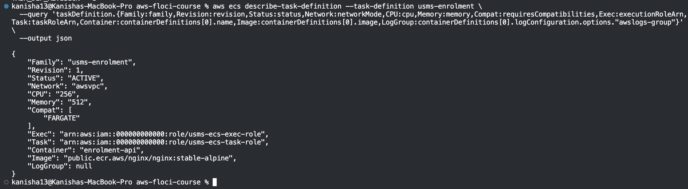

**Step 10 – Create the service** `usms-enrolment-svc` with 2 tasks across the two private subnets, with no public IP.

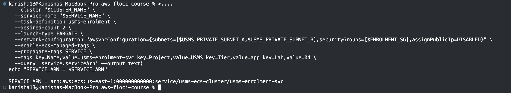

### Part D – Checking and saving

**Step 11 – Read the service back.** Looked at the health numbers (desired, running, pending, status).

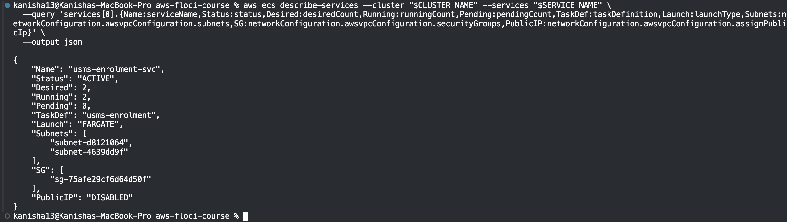

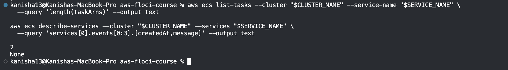

**Manual scaling.** Raised the wanted count from 2 to 3, then back to 2. This is what automatic scaling will do on its own in Lab 06.

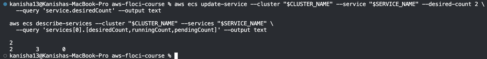

**Step 12 – Save everything to `configs/lab-04.env`.** 17 values, all filled in.

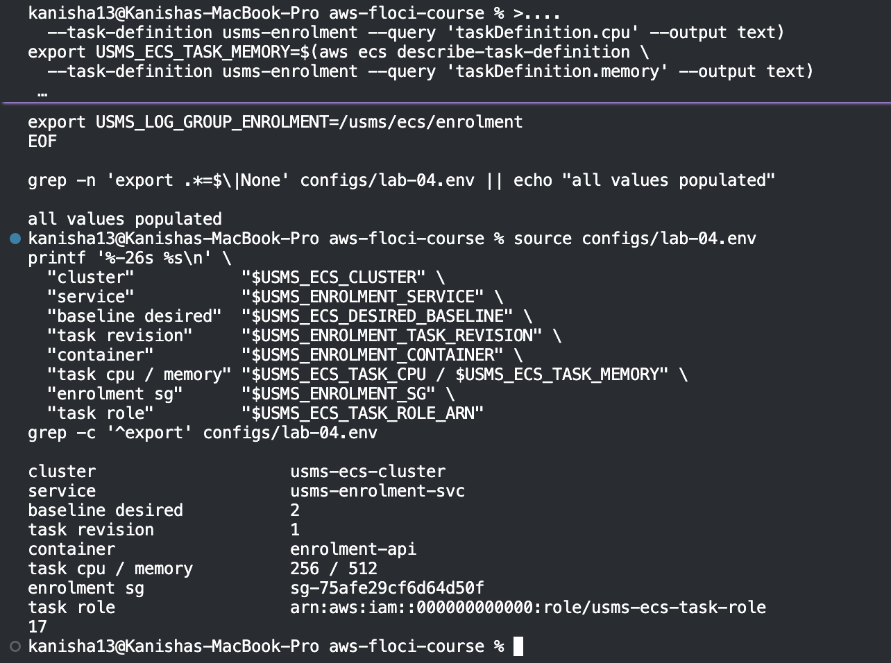

### Part E – Verification

**Step 13 – Run the check script.** Built `verify-lab-04.sh`, which checks 38 things: the environment, the roles, the logs, the cluster, the service and the firewall rule. Result: **37 passed, 1 failed**.

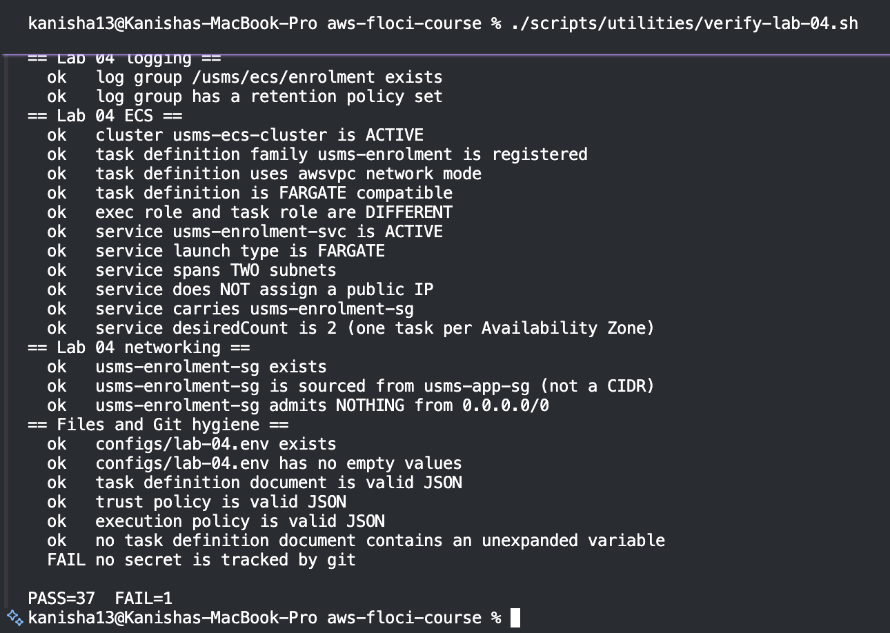

**The one failure, explained:** the check "no secret is tracked by git" fails because the script flags *any* file under `outputs/`. The only one is `outputs/.gitkeep`, an empty placeholder that keeps the folder in Git. It holds no secrets, and the folder's real contents are ignored by `.gitignore`. So this is a false alarm in the script, not a problem with the work.

---

## 4. Challenges Faced and How They Were Solved

| # | Challenge | Cause | Fix |
|---|---|---|---|
| 1 | Private subnet b was `None`. | Lab 2 Exercise 5 (the second Availability Zone) had been skipped. | Completed Lab 2 Exercise 5 and saved the new subnet ID. |
| 2 | Lab 2 verify showed `FAIL=2`. | An unused optional line (`USMS_PUBLIC_SUBNET_B=None`) in the env file, and a check that flagged `outputs/.gitkeep`. | Commented out the unused line. The `.gitkeep` flag was a false alarm because it is an empty placeholder with no secrets. |
| 3 | The probe said `describe-services` was "not available". | The probe treats any error as failure, but ECS had answered "cluster not found", so ECS works. | Checked it by hand. Only scheduled scaling is truly unsupported. |
| 4 | Attaching the policy to the task role failed (`NoSuchEntity`). | The env variable already held the **full policy ARN**, so the lab's command added the prefix twice. | Used the variable directly as the ARN. |
| 5 | The assumed role showed the session name `floci-session`, and service events were `None`. | Floci limitations. | Noted them. They don't affect the result. |

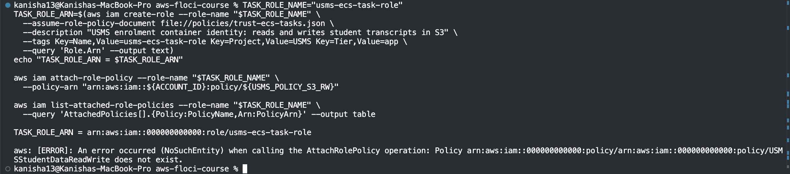

---

## 5. Conclusion

An ECS cluster, service and task definition were built for the USMS enrolment service. The service holds two tasks in two private subnets across two Availability Zones, with no public IP. A separate execution role and task role keep "starting the container" apart from "what the app is allowed to do". The firewall accepts traffic only from the web tier's security group.

Changing the desired count by hand showed that ECS only needs a number to adjust capacity, which Lab 06's auto scaling will change for us. Several problems came up (a skipped earlier exercise, a doubled ARN, misleading probe and verify results), and each was found by reading the error and checking the real state. The lab's own notes call out the Floci limits, such as containers not always starting and scheduled scaling being unsupported, and these did not block the work.
