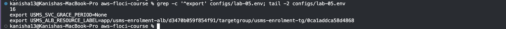
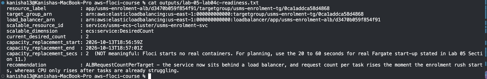

# Lab 05 – Independent Exercises

Only Exercise 5 is done here, because Lab 6 needs its result. Exercises 1 to 4 were not done.

## Exercise 5 – The ResourceLabel hand-off to Lab 06

**Task:** Lab 6 scales the service on request count per task (`ALBRequestCountPerTarget`). That metric needs a "ResourceLabel", made of two pieces of ARN: the load balancer's and the target group's. I wrote a script to build it from the API, saved it in `configs/lab-05.env`, and wrote a readiness file for Lab 6.

### 1. The script

`scripts/utilities/usms-resource-label.sh` takes a load balancer name and a target group name (defaulting to this lab's two), looks up both ARNs from the API, and prints the label. It does not read `configs/lab-05.env`, uses no access keys, and works from any folder.

The two pieces are cut differently, with shell parameter expansion:
- **Load balancer:** `${LB_ARN#*:loadbalancer/}` drops everything up to and including `loadbalancer/`, leaving `app/usms-enrolment-alb/<id>`.
- **Target group:** `${TG_ARN##*:}` drops only the account and region part, so the word `targetgroup/` is kept: `targetgroup/usms-enrolment-tg/<id>`.

Before printing, the script checks that the label has exactly six segments, starts with `app`, and contains both names. It refuses with an error otherwise.

```bash
./scripts/utilities/usms-resource-label.sh

```


### 2. Saving it to `configs/lab-05.env`

The value is derived by the script, not typed:

```bash
echo "export USMS_ALB_RESOURCE_LABEL=$(./scripts/utilities/usms-resource-label.sh)" >> configs/lab-05.env
```

The file now has **16 exports** (it had 15). The only `None` is the grace period, which Floci does not store (see the Lab 5 report).



### 3. Checking the label

The label has six slash-separated segments: `app`, the load balancer name, the load balancer ID, `targetgroup`, the target group name, the target group ID. The first segment is the literal `app`, and both names are in it.

**Why `app`:** it is the load balancer type in the ARN. It stands for Application Load Balancer. A Network Load Balancer's ARN would start with `net` instead.

### 4. Measuring how long it takes to replace all the tasks

I recorded a UTC time with `python3`, forced a new deployment, polled until there was exactly one deployment and the target list had stopped changing, and recorded the time again.

| | |
|---|---|
| Start | 2026-10-3T18:56:59Z |
| End | 2026-10-3T18:57:01Z |
| Elapsed | 2 seconds |

**This number is not meaningful.** Floci starts no real containers, and its target group stays empty, so a "replacement" finishes immediately. For planning Lab 6's cooldowns, I use the 20 to 60 seconds for real Fargate task start-up that Lab 5, Section 11 gives instead.

### 5. The readiness file

`outputs/lab-05-lab04c-readiness.txt` holds everything needed to write Lab 6's scaling policy:

| Item | Value |
|---|---|
| Resource label | `app/usms-enrolment-alb/d3470b059f854f91/targetgroup/usms-enrolment-tg/0ca1addca58d4868` |
| Scalable resource ID | `service/usms-ecs-cluster/usms-enrolment-svc` |
| Scalable dimension | `ecs:service:DesiredCount` |
| Current desired count | 2 |

**Recommended metric:** `ALBRequestCountPerTarget`. The service now sits behind a load balancer, and the number of requests per task jumps as soon as the enrolment rush begins. CPU only rises after the tasks are already struggling.


