# Lab Report: Lab 5 – Application Load Balancer in Front of ECS

---

## 1. Objectives

- Put a stable front door (an Application Load Balancer) in front of the ECS enrolment service I built in Lab 4.
- Keep the tasks private, so the only way in from the internet is through the load balancer.
- Build the pieces for it: a firewall for the load balancer, the load balancer itself, a target group, a listener and a listener rule.
- Connect the ECS service to the target group, then remove the old direct path to the tasks.
- Prove the setup survives a restart, and save the names and IDs to `configs/lab-05.env` for Lab 6.

---

## 2. What is a load balancer? (in plain words)

The tasks from Lab 4 have private, temporary addresses and no name. A **load balancer** gives them one permanent address. Visitors always connect to the load balancer, and it passes each request to a healthy task.

| Term | Everyday meaning |
|---|---|
| Load balancer (ALB) | The reception desk. Everyone arrives here first |
| Listener | The door the visitor knocks on (port 80) |
| Rule | A sign saying "if the visitor wants X, do Y" |
| Target group | The list of tasks that can serve visitors, plus a health check to see which are working |
| Health check | A regular "are you OK?" ping to each task |
| Security group | The firewall that decides who may connect |

---

## 3. Steps Followed

### Part 0 – Fixing something I skipped earlier

Lab 5 needs **two public subnets** in two zones, but I had skipped the optional second one in Lab 2. I created `usms-public-subnet-b` (10.0.2.0/24, us-east-1b), turned on public IPs, linked it to the public route table, and saved its ID in `configs/lab-02.env`.

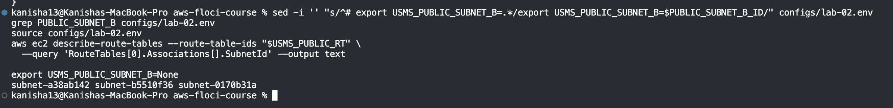

### Part A – Setup

**Step 1 – Start Floci and load the settings from earlier labs.** All twelve values had to be filled in.

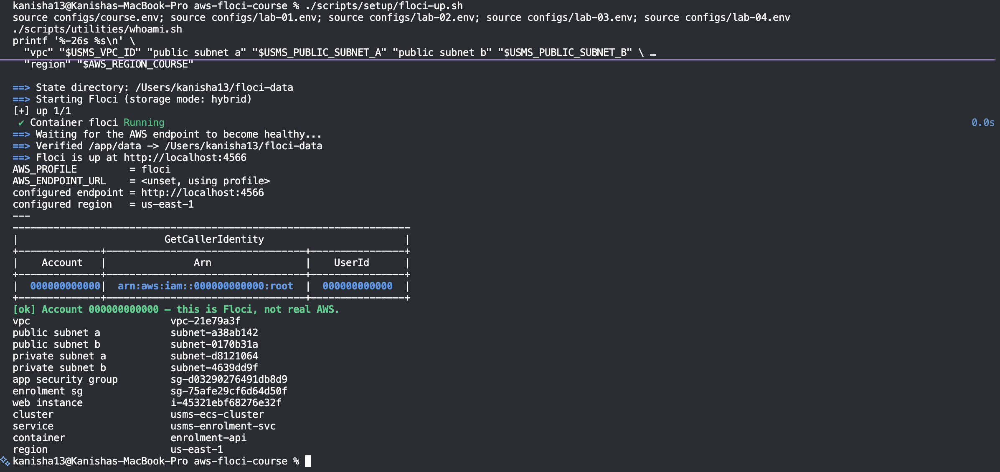

**Step 2 – Check Labs 2, 3 and 4 still work**, and save Lab 4's result as a "before" copy.

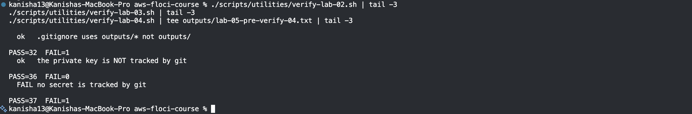

**Step 3 – Check what this Floci build supports for load balancing.**

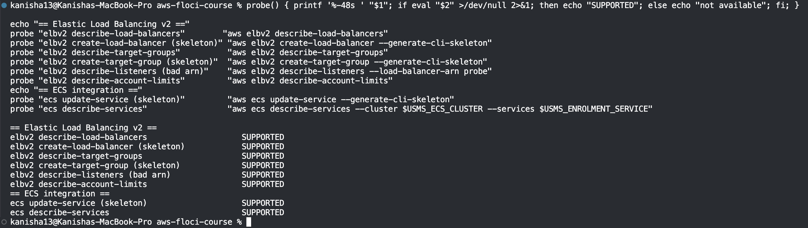

### Part B – Building the load balancer

**Step 4 – Create the load balancer's firewall** (`usms-alb-sg`). It allows web traffic on port 80 from anywhere. This is the only rule in the course open to the whole internet, and it is on purpose.

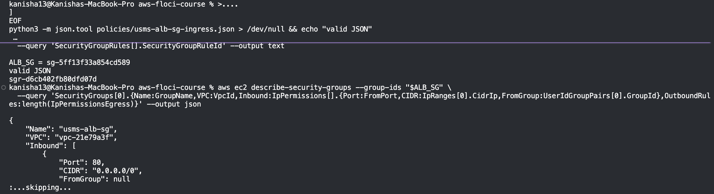

*My turn:* I also added a port 443 rule from a JSON file.

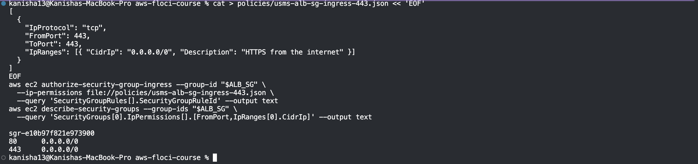

**Step 5 – Create the load balancer** `usms-enrolment-alb`: internet-facing, in both public subnets.

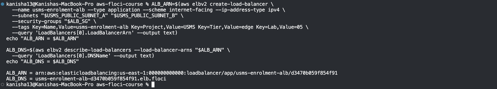

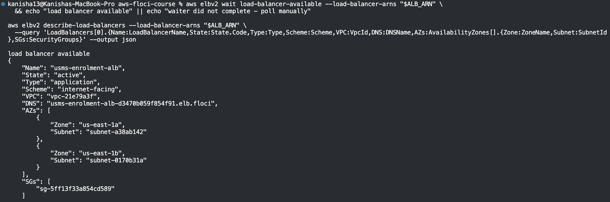

I also set two attributes: a 60-second idle timeout and dropping invalid headers.

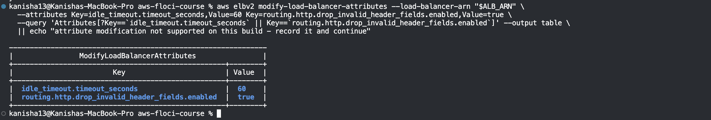

**Step 6 – Create the target group** `usms-enrolment-tg`: type `ip` (needed for Fargate), port 80, health check on `/` every 30 seconds.

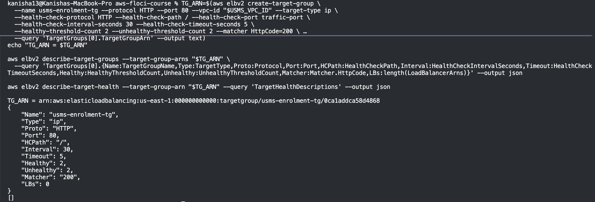

*My turn:* I widened the health check to accept 200-399, then set it back to 200.

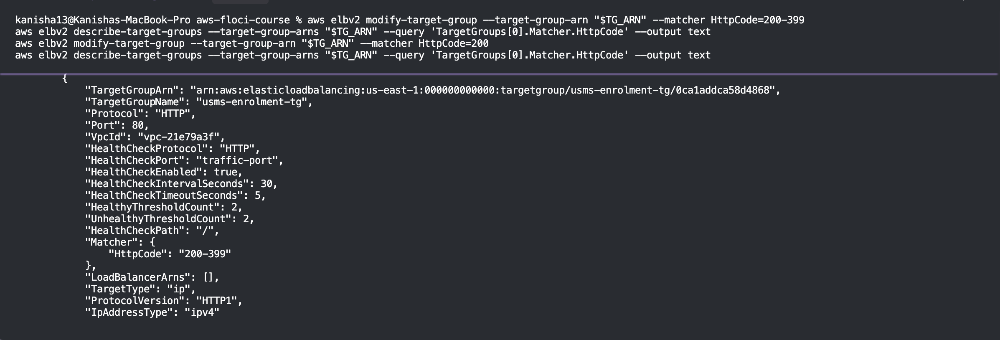

**Step 7 – Set how a task shuts down.** A 30-second drain delay lets in-flight requests finish. I also chose "least outstanding requests" routing.

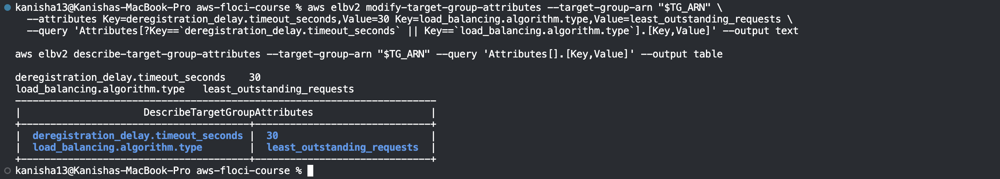

**Step 8 – Create the listener** on port 80, forwarding to the target group.

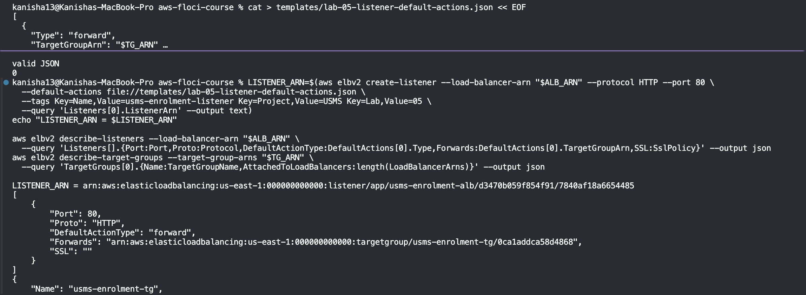

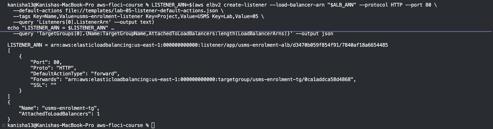

### Part C – Connecting the service

**Step 9 – Let the load balancer reach the tasks.** I added a rule on the tasks' firewall allowing port 80 from the load balancer's firewall.

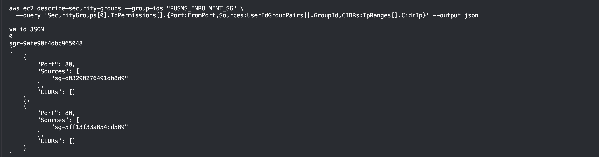

**Step 10 – Attach the ECS service to the target group.** This did not work the first time (see Challenges). I recreated the service with the load balancer attached.

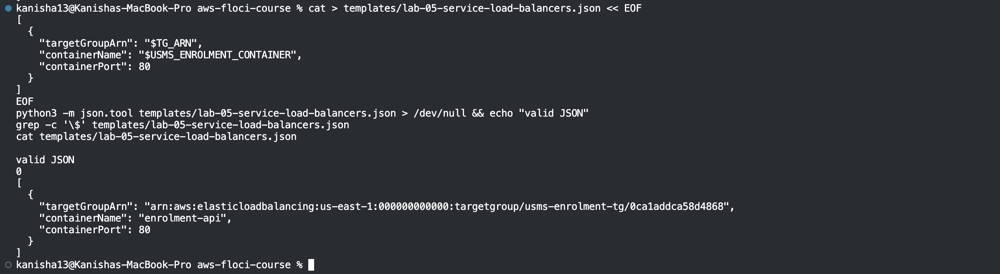

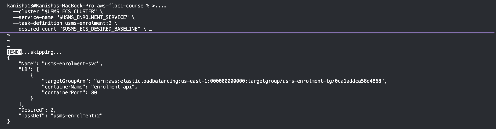

**Step 11 – Watch the targets register.** The target group stayed empty on this Floci build.

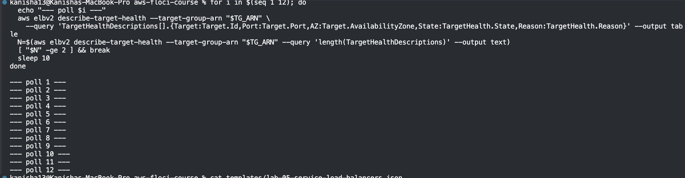

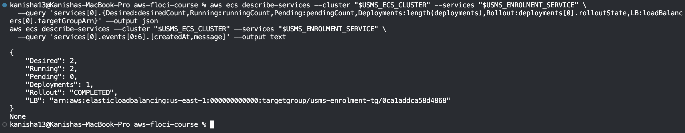

*My turn:* I raised the desired count to 3 and then put it back to 2.

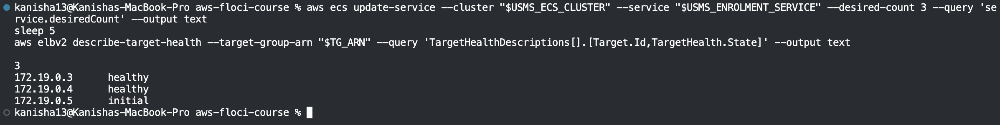

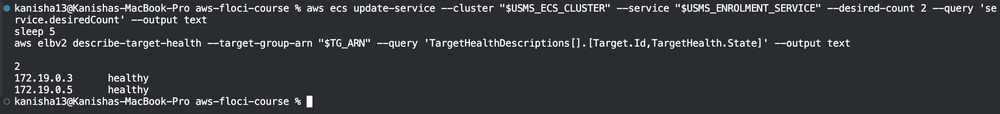

**Step 12 – Prove the path.** I tried a real request first, then used the control-plane proof (what the settings say).

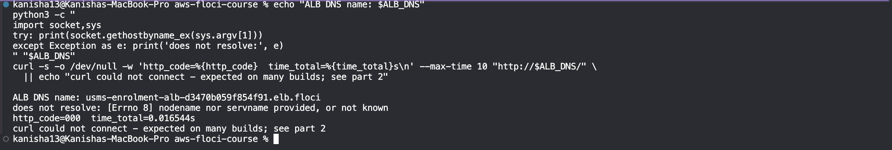

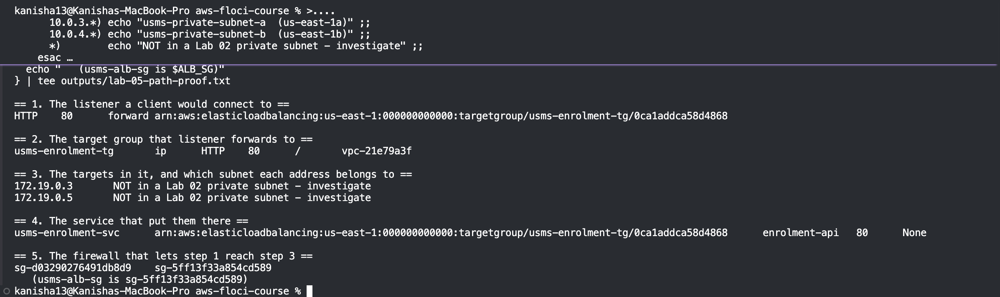

**Step 13 – The cutover: remove the old direct path.** Only the load balancer should reach the tasks now. I found the old rule from the web server's group and removed it.

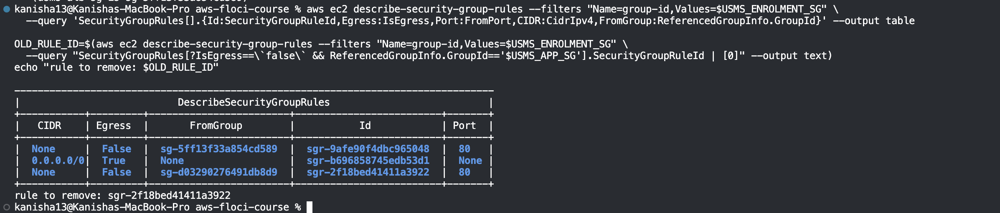

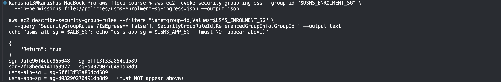

Lab 4's check script now correctly reports one extra failure, because it still describes the old design:

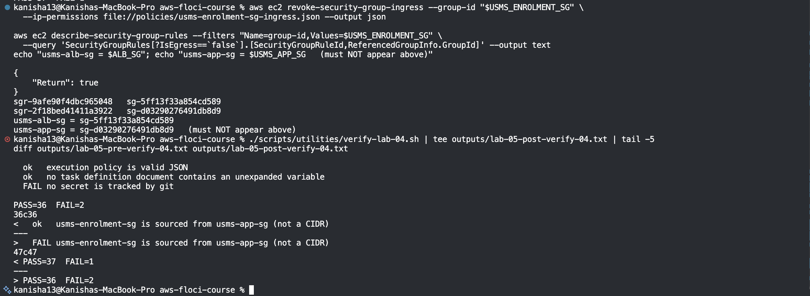

### Part D – Deployment, rules and restart

**Step 14 – Deploy behind the load balancer.** I forced a new deployment with no changes and watched both sides.

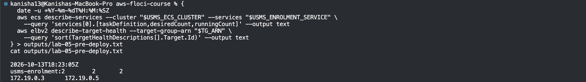

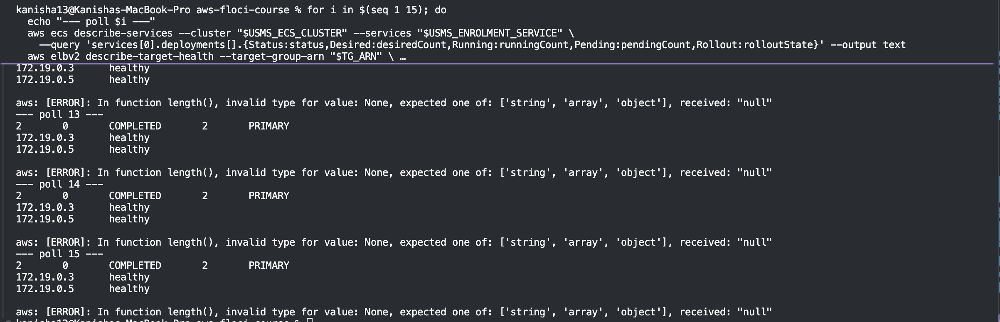

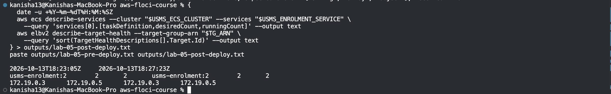

**Step 15 – Add a listener rule.** Requests to `/alb-health` get an instant "OK" answer from the load balancer itself. Everything else goes to the tasks.

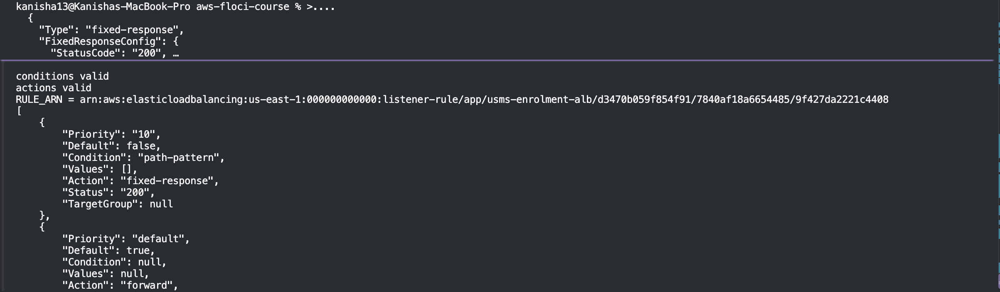

**Step 16 – Prove it survives a restart.** I recorded the setup, stopped and started Floci, looked everything up again, and compared.

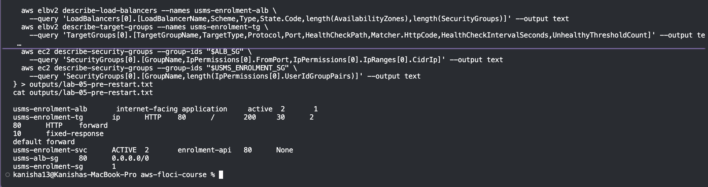

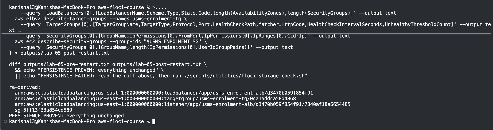

**Step 17 – Close the loop and audit.** I checked who can reach the load balancer, who can reach the tasks, and that the web server from Lab 3 is still the client.

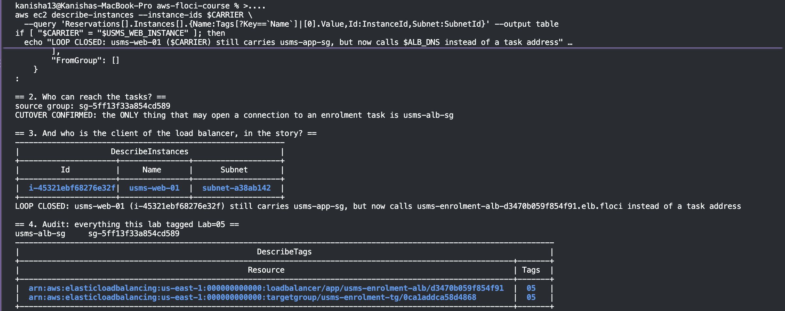

**Step 18 – Save everything to `configs/lab-05.env`.**

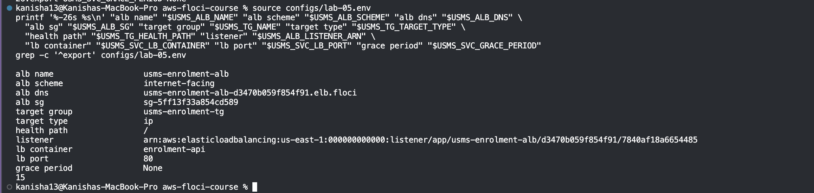

### Part E – Verification

I built `verify-lab-05.sh`, which runs 49 checks. Result: **46 passed, 3 failed**. All three are explained in the Challenges section.

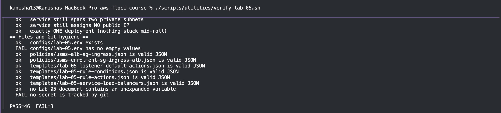

---

## 4. Challenges Faced and How I Solved Them

| # | Challenge | Cause | What I did |
|---|---|---|---|
| 1 | Public subnet b was missing, and the load balancer needs two. | I skipped the optional part of Lab 2. | Created the subnet, linked it to the public route table, and fixed the env file. The first save did not stick because the file still said `None`, so I corrected the line by hand. |
| 2 | The target group stayed empty. | I ran `update-service` with the load balancer, but Floci accepted it and quietly ignored it. The service showed no load balancer. | I tested with a throwaway service. `create-service` did store the load balancer, so I deleted and recreated the real service with the same name, task definition and desired count. |
| 3 | The health check grace period shows as `None`. | Floci does not store this setting, on either command. | Recorded it as a limitation. It causes two of the three verify failures. |
| 4 | The cutover looked like it worked but did not. | Removing the old rule by its ID returned `true`, but Floci did nothing. | I removed it using the same JSON file that created it. This worked, and the check showed only the load balancer as a source. |
| 5 | The rule list still showed the removed rule. | Floci does not refresh that particular view. | I used the security group view instead as proof. |
| 6 | The listener line in `lab-05.env` came out empty. | The backtick escaping in the lab's command did not work in my shell. | Looked up the listener and put the value in myself. |
| 7 | No real request could be sent to the load balancer. | Floci has no public DNS or data path for load balancers. | Used the control-plane proof the lab provides, and did not claim a result I did not see. |
| 8 | The verify script reported `FAIL=3`. | (1) grace period not stored, (2) the env file has `None` because of it, (3) `outputs/.gitkeep` is flagged as a "secret", but it is just an empty placeholder. | All three are Floci limits or script quirks, not mistakes in the work. |

---

## 5. What I observed and what I only reasoned about

**Observed:** the load balancer, target group, listener and rule; the security group chain; the service's load balancer entry; the cutover; and the whole setup surviving a restart.

**Only reasoned about:** a real request reaching a task, targets turning healthy or draining, and the timings (start-up, grace period). Floci does not run these.

---

## 6. Conclusion

I put an internet-facing Application Load Balancer in front of the enrolment service. A listener forwards requests to a target group, and the tasks are only reachable from the load balancer's firewall. After proving the new path, I removed the old direct path, so there is now one clear way in. The setup also survived a restart of Floci.

The main lesson was to check, not trust. Several commands said they worked (`true`, no error) but did nothing, so each change had to be read back. Floci also could not do everything a real AWS account can: targets never registered, the grace period was not stored, and no real request could be sent. These were recorded honestly instead of being worked around. The service keeps its name, its desired count of 2 and its load balancer entry, so Lab 6 can build auto scaling on top of it.
