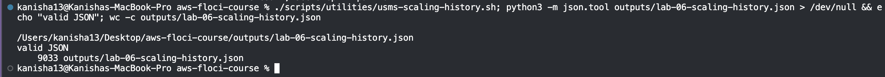
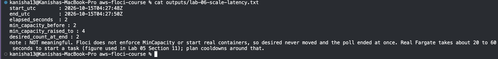
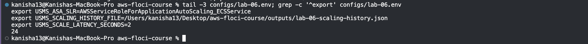
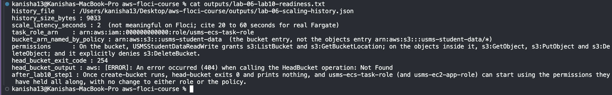

# Lab 06 – Independent Exercises

Only Exercise 5 is done here, because Lab 10 needs its result. Exercises 1 to 4 were not done.

## Exercise 5 – The hand-off to Lab 10

**Task:** Lab 10 will create the bucket `usms-student-data`, and its first upload needs a real file. I wrote a script that exports the service's whole scaling setup to one JSON file, measured how long it takes to add capacity, and wrote a readiness note for Lab 10.

### 1. The export script

`scripts/utilities/usms-scaling-history.sh` writes `outputs/lab-06-scaling-history.json`. It finds everything from the API, so no resource ID, policy name or alarm name is typed in it, and it works from any folder. The file contains:
- a `generated` UTC time (from `python3`) and a `resourceId` taken from the service's ARN;
- the scalable target, with its bounds and suspension state;
- all three scaling policies with their full settings;
- the scheduled actions, the alarms (the managed ones and my own, with their state), and the scaling activities.

If Floci does not support a call, the script writes the error message into the file instead of stopping. Floci does not support scheduled actions or scaling activities, so those two sections hold an error message. The file is valid JSON (checked with `python3 -m json.tool`) and is **9,033 bytes**.

```bash
./scripts/utilities/usms-scaling-history.sh
python3 -m json.tool outputs/lab-06-scaling-history.json > /dev/null && echo "valid JSON"
wc -c outputs/lab-06-scaling-history.json
```



### 2. Measuring how long adding capacity takes

I recorded the time, raised `MinCapacity` to 4, polled until the running count matched the desired count, recorded the time again, and put the floor back to 2.

| | |
|---|---|
| Start | 2026-10-4T04:27:48Z |
| End | 2026-10-15T04:27:50Z |
| Elapsed | 2 seconds |
| Floor | 2 → 4 → 2 |

**This number is not meaningful.** Floci does not enforce the floor or start real containers, so the desired count stayed at 2 and the check ended at once. For planning, I use the 20 to 60 seconds that real Fargate takes to start a task (the figure in Lab 5, Section 11). The result is saved in `outputs/lab-06-scale-latency.txt`.



### 3. Saving to `configs/lab-06.env`

I added two lines, `USMS_SCALING_HISTORY_FILE` and `USMS_SCALE_LATENCY_SECONDS`. The file now has **24 exports** and no empty values.



### 4. The readiness file for Lab 10

`outputs/lab-06-lab10-readiness.txt` records:

| Item | Value |
|---|---|
| History file and size | `outputs/lab-06-scaling-history.json`, 9,033 bytes |
| Latency | 2 s (not meaningful; cite 20 to 60 s) |
| Task role | `arn:aws:iam::000000000000:role/usms-ecs-task-role` |
| Bucket named by the policy | `arn:aws:s3:::usms-student-data` |

I read the bucket ARN from the policy itself with `get-policy-version`. The policy has two resource entries, and I recorded the **bucket** one, not the objects one (`.../usms-student-data/*`).

**What the policy grants:** `USMSStudentDataReadWrite` allows listing the bucket and getting its location, allows getting, putting and deleting objects inside it, and explicitly denies deleting the bucket itself.

**The bucket does not exist yet.** I ran `aws s3api head-bucket --bucket usms-student-data`, and it failed with exit code **254** (`Not Found`). After Lab 10's first step creates the bucket, the same command succeeds with exit code 0 and prints nothing. `usms-ecs-task-role` can then start using permissions it has held all along, with no change to the role or the policy.


