# Lab Report: Lab 6 – Auto Scaling for the ECS Service
**Course:** DSO303
**Lab Reference:** Lab 06 - Auto Scaling (AWS CLI + Floci local emulator)

---

## 1. Objectives

- Let the enrolment service change its own size when demand changes, instead of me editing the number by hand.
- Register the service as something that can be scaled, with a floor of 2 and a ceiling of 10 tasks.
- Build three kinds of scaling: one that follows CPU, one that follows requests per task, and one that reacts to a work-queue backlog.
- Try scheduled scaling, and learn how to switch scaling off and on safely.
- Prove the whole setup survives a restart, and save the names and IDs to `configs/lab-06.env`.

---

## 2. What is auto scaling? (in plain words)

In Lab 4 I set the service to run 2 tasks and left it there. **Auto scaling** changes that one number for me. It does not change the application. It only changes how many copies are running, and ECS and the load balancer do the rest.

| Term | Everyday meaning |
|---|---|
| Scalable target | The "this number may move between 2 and 10" sign |
| Target tracking policy | A thermostat: it keeps one measurement (like CPU) near a goal |
| Step scaling policy | A rule with sizes: "backlog of 100 adds 1 task, backlog of 200 adds 3" |
| Scheduled action | A timetable: "raise the floor at 07:45 on weekdays" |
| Alarm | The watcher that notices a measurement is too high or low and calls the policy |
| Cooldown | A pause after a change, so it does not overreact |

Reactive scaling is always a little late. The measurement has to be collected, compared, and then a new task has to start. That takes two to five minutes, which is why the floor (the minimum) and the timetable matter.

---

## 3. Steps Followed

### Part A – Setup

**Step 1 – Start Floci and load the settings from Labs 1 to 5.**

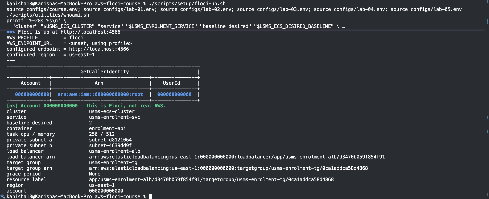

**Step 2 – Check the earlier labs and the service state** (2 tasks wanted, 1 deployment, 1 load balancer).

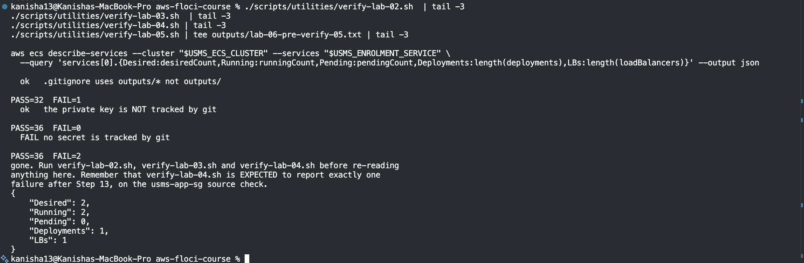

**Step 3 – Check what this Floci build supports.** Scaling targets, policies and alarms work. Scheduled actions and scaling history do not.

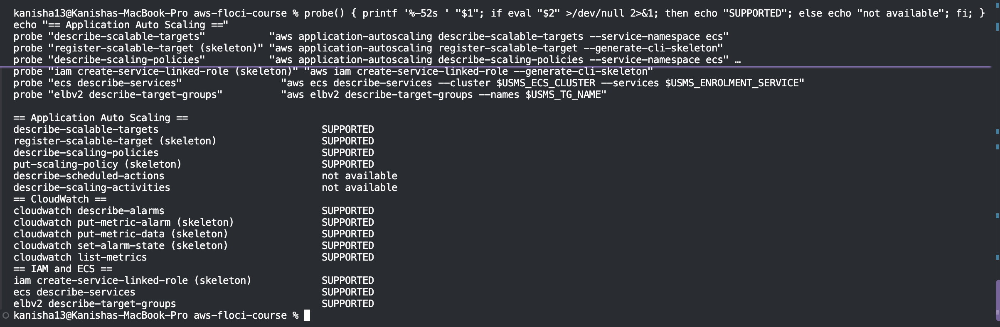

### Part B – The scalable target

**Step 4 – The service-linked role.** This is the identity AWS uses to change the task count for me.

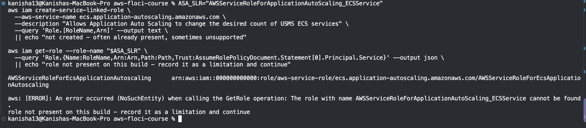

**Step 5 – Register the scalable target.** Its ID is built from the service's ARN: `service/usms-ecs-cluster/usms-enrolment-svc`. Minimum 2, maximum 10.

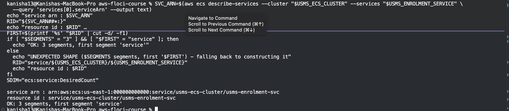

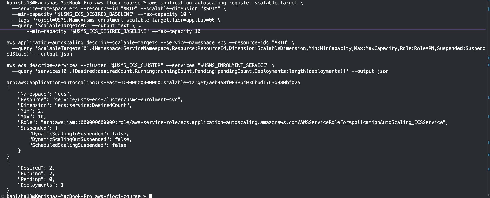

**Step 6 – Change the limits.** There is no "update" command, so I registered again. I raised the ceiling to 12 and put it back.

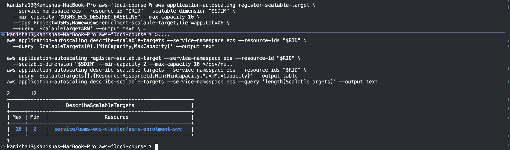

*My turn:* I set the minimum to 5 while 2 tasks were running. On real AWS the count would jump to 5 straight away. On Floci it stayed at 2.

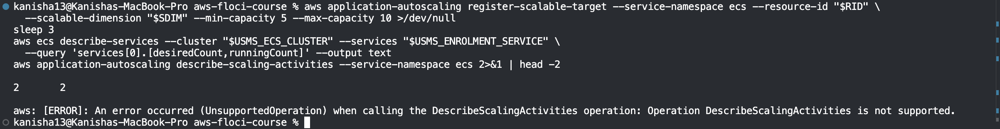

I then put the minimum back to 2 and set the count back to 2 by hand, because lowering the minimum does not lower the count.

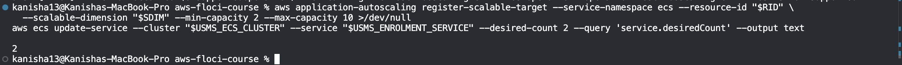

### Part C – The scaling rules

**Step 7 – The CPU policy.** It keeps average CPU near 50%, scaling out after 60 seconds and in after 300.

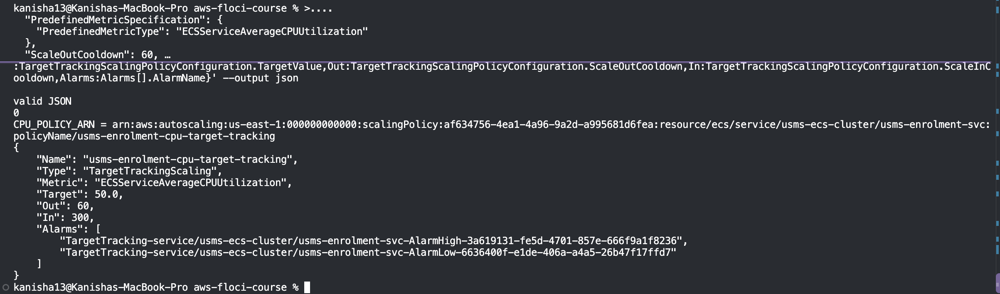

**Step 8 – The two alarms it created for me** (a "too high" and a "too low" one). I did not edit them.

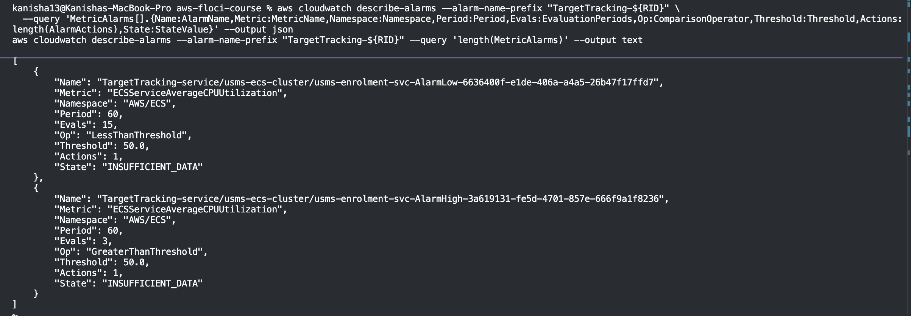

**Step 9 – The request-count policy.** It aims for 1000 requests per task. It uses the label I built in Lab 5 Exercise 5 (six parts, starting with `app`).

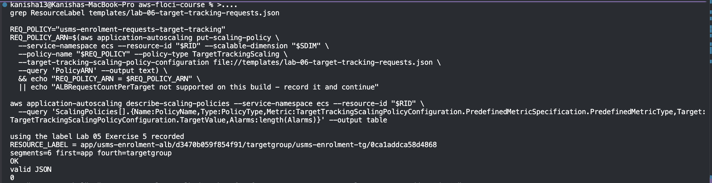

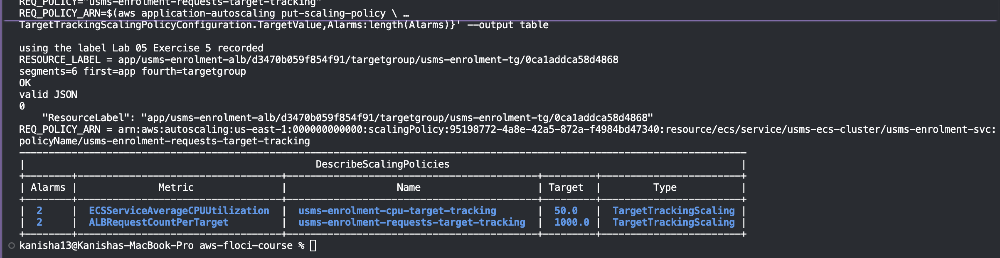

**Step 10 – The step policy and its alarm.** A backlog of 100 to 200 adds 1 task, and 200 or more adds 3. I published the queue measurement myself and made an alarm that calls the policy.

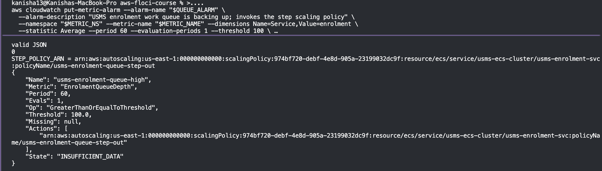

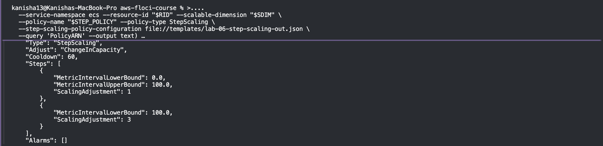

**Step 11 – Scheduled actions.** I tried to create a weekday 07:45 action (floor 4) and a 20:00 action (floor 2). Floci does not support these, so they could not be created.

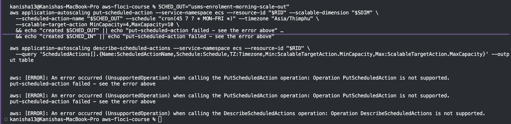

### Part D – Trying it out

**Step 12 – Fire the alarm.** I predicted that a queue of 260 against a threshold of 100 is a breach of 160, which should add 3 tasks (2 to 5). I pushed the metric up and forced the alarm into the "alarm" state. The task count did not move, so Floci does not run the scaling loop.

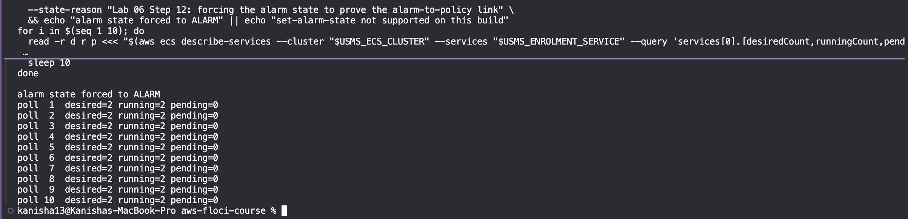

Because nothing moved, I used the lab's second proof, which shows the whole chain from the settings: the alarm watches the queue, it calls the step policy, the policy belongs to this target, a breach of 160 picks "+3", and the ceiling is 10.

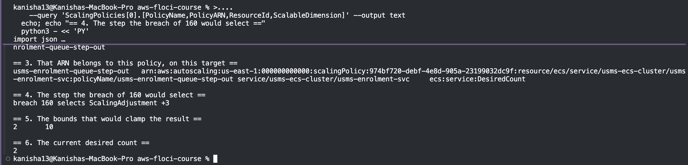

I then pushed the metric back down and set the count back to 2.

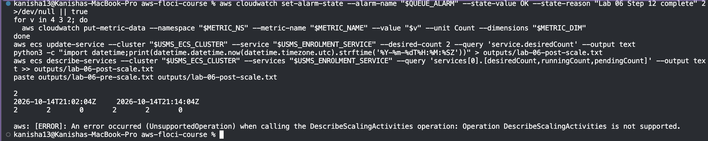

**Step 13 – Switch scaling off and on.** I suspended only scale-in, saw that all policies and alarms stayed in place, then resumed. All three switches are off again, which matters because a suspension is invisible otherwise.

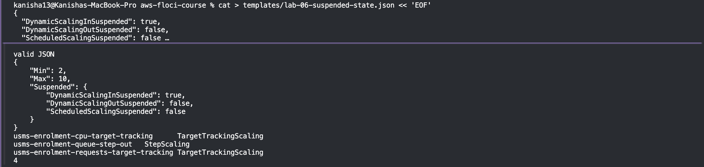

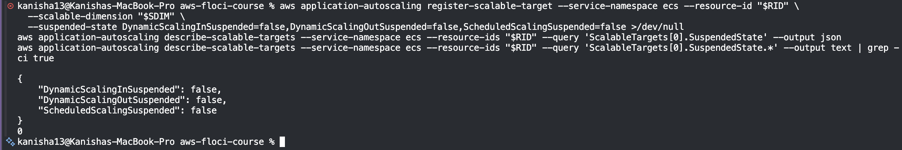

### Part E – Restart, closing the loop and saving

**Step 14 – Survives a restart.** I recorded the setup, stopped and started Floci, looked everything up again, and compared.

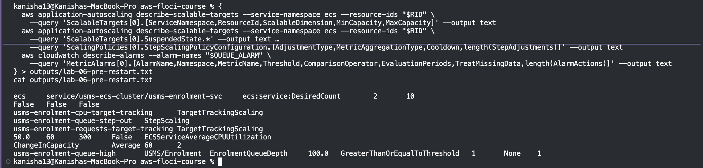

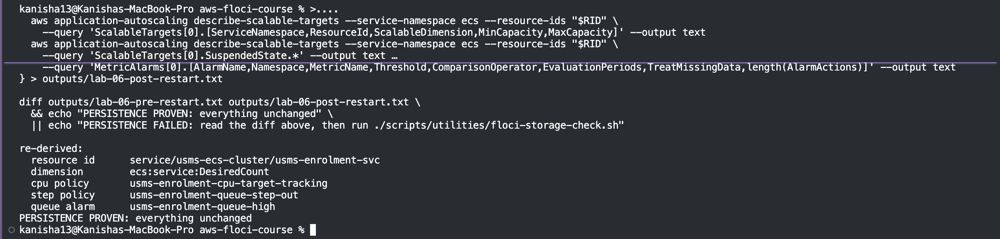

**Step 15 – Close the loop.** I walked from the measurement to the alarm, the policy, the number, the service, the network and the load balancer. This lab is responsible for only three of the nine links. Everything else was built in Labs 4 and 5 and is unchanged.

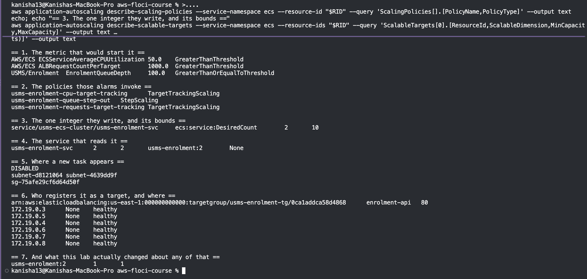

**Step 16 – Save everything to `configs/lab-06.env`.**

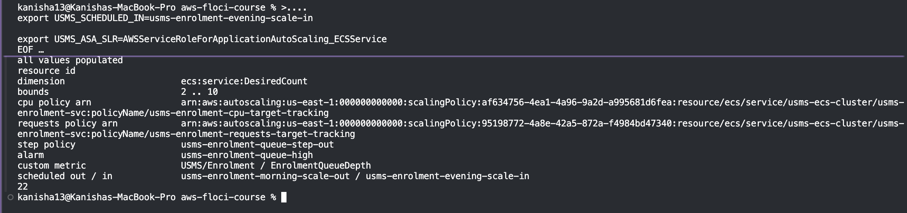

### Part F – Verification

I built `verify-lab-06.sh`, which runs 42 checks. Result: **38 passed, 4 failed**. The failures are explained below.

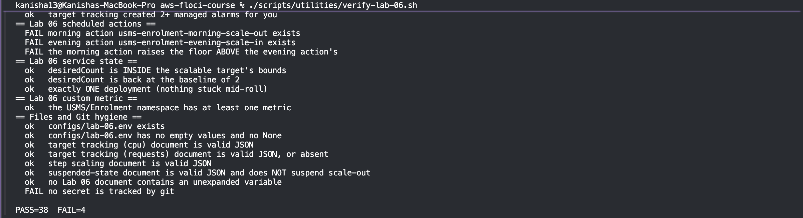

---

## 4. Challenges Faced and How I Solved Them

| # | Challenge | Cause | What I did |
|---|---|---|---|
| 1 | Scheduled actions could not be created or read. | Floci does not support them (`UnsupportedOperation`), which I had seen in my first test in Lab 4. | Recorded it as a limit. The names are kept in `lab-06.env`, and this causes three of the four verify failures. |
| 2 | Raising the minimum to 5 did not change the count. | Floci stores the minimum but does not enforce it. | Recorded it. On real AWS the count would jump to 5 at once. |
| 3 | Forcing the alarm did not scale anything, and no scaling history could be read. | Floci does not run the scaling loop and does not support the history call. | Used the lab's second proof (the six-part chain), and stated plainly that the wiring is proven but I did not see a scaling event. |
| 4 | The step policy showed an empty list of alarms. | Floci does not fill in the policy's alarms. The link is stored only on the alarm itself. | Checked the alarm directly: its action is the step policy's ARN. |
| 5 | The task count stayed raised after I lowered the minimum. | Lowering the floor never lowers the count by itself. | Set the count back to 2 by hand each time. |
| 6 | The resource ID in `lab-06.env` came out empty, twice. | The lab's `awk` command lost its `$` when written through the file. The second time, the file was rewritten and wiped my first fix. | Filled the line in by hand, and did not run that block again. |
| 7 | The verify script showed an extra failure at one point. | That blank resource ID. | Fixed the line, and the count dropped to the four expected failures. |
| 8 | The last verify failure, "no secret is tracked by git". | `outputs/.gitkeep` is flagged, but it is an empty placeholder. | Noted it as a false alarm, as in earlier labs. |

---

## 5. What I observed and what I only reasoned about

**Observed:** the target and its limits, all three policies, the managed and custom alarms, suspending and resuming, the setup surviving a restart, and the alarm being linked to the step policy.

**Only reasoned about:** a scaling event actually happening, the timing of start-up and cooldowns, and scheduled scaling. Floci does not run these.

---

## 6. Conclusion

I turned the fixed enrolment service into one that can change its own size. It is registered as a scalable target with a floor of 2 and a ceiling of 10, with a CPU policy, a request-count policy and a step policy driven by my own queue alarm. I could switch scaling off and on, and I proved the whole setup survives a restart.

The most important lesson was that auto scaling only changes one number, and that it is always late, because collecting the measurement and starting a task take minutes. That is why the floor and a timetable matter. On this Floci build I could not see a scaling event happen, could not create scheduled actions, and the floor was not enforced. I recorded those honestly and proved the wiring instead of claiming results I did not see. The service keeps its name, its 2 tasks and its load balancer, so later labs can build on it.
